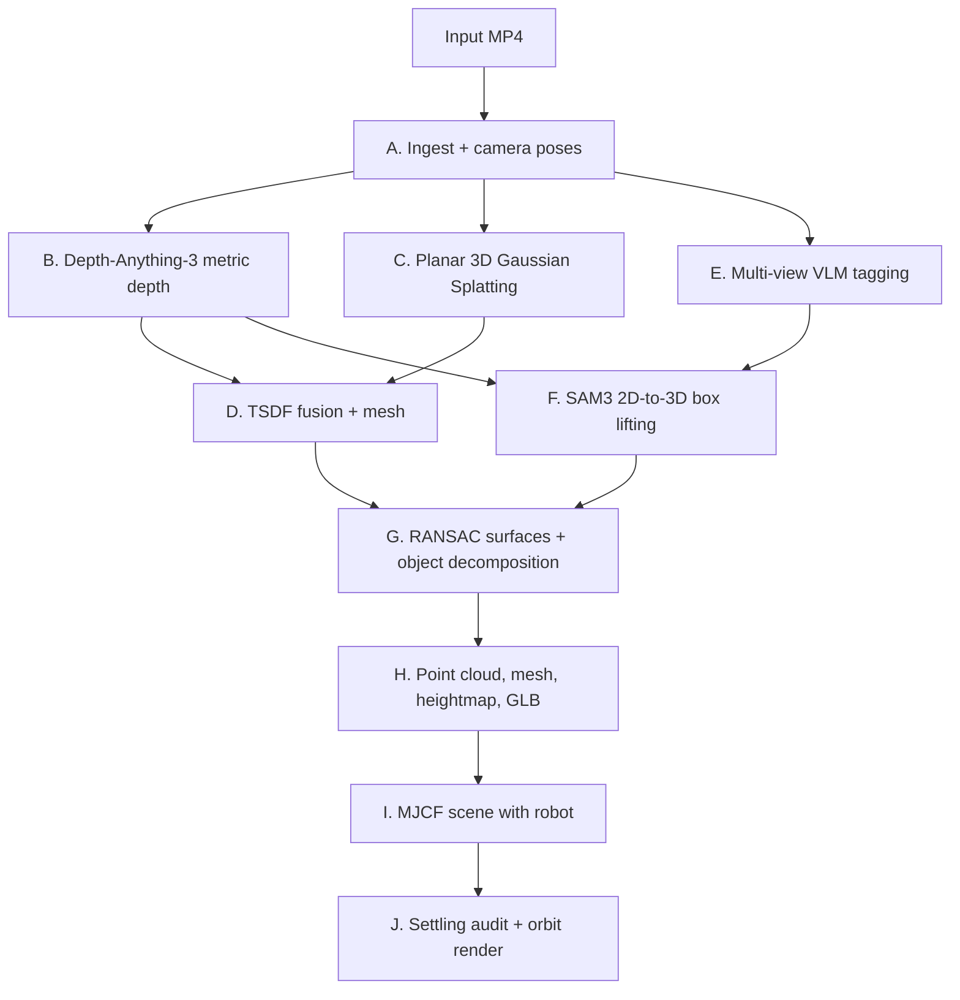

# Video-to-3D

Turn a handheld or drone RGB video scan into a physics-ready, semantically
labelled 3D environment: point cloud, mesh, heightfield, semantic 3D boxes, and a
MuJoCo scene a Unitree robot can walk around in.



## Quickstart

```bash
make setup     # create .venv, install pinned deps, install v3d editable
make test      # geometry + pose regression tests, must print "all checks passed"
make help      # every other target
```

`make setup` uses [uv](https://docs.astral.sh/uv/) when it is on PATH and plain
`venv` + `pip` otherwise. Python must be 3.10–3.13: `depth-anything-3` declares
`<=3.13`, and the DA3 stages import it in-process. The known-good combination is
Python 3.11 with the versions pinned in [requirements.txt](requirements.txt).

Then copy the secrets template and fill it in:

```bash
cp .env.example .env    # Kaggle proxy URL, NVIDIA NIM keys, Groq keys, HF token
```

## Layout

```text
Videos_to_3D/
├── README.md               You are here
├── AGENTS.md               Engineering rules and invariants for AI assistants
├── Makefile                Every entry point: make help
├── pyproject.toml          Package metadata for src/v3d
├── requirements.txt        Pinned versions known to work together
│
├── src/v3d/                The Python package — the only importable code
│   ├── config.py             PipelineConfig / SceneLayout dataclasses
│   ├── paper_runner.py       Stage dispatcher and CLI (`v3d --stage ...`)
│   ├── ingest/               Frame extraction, focal pooling, pose math
│   ├── geometry/             Adaptive quality knobs, PGSR build, TSDF
│   ├── semantic/             VLM prompting and label voting
│   ├── scene/                Plane RANSAC, box decomposition, scene schema
│   ├── export/               GLB, terrain heightfield, Blender, visualisation
│   ├── validate/             Stage J physics checks, ground-truth box compare
│   └── data/                 ScanNet++ and HF tar dataset access
│
├── scripts/                Executables, grouped by where they run
│   ├── kernel/               Runs INSIDE the Kaggle GPU kernel (25)
│   ├── kaggle/               Runs LOCALLY, talks to Kaggle over the proxy (13)
│   ├── deploy/               Runs LOCALLY, deploys to an SSH GPU server (2)
│   ├── sim/                  MuJoCo scene build, validate, render (6)
│   ├── adapter/              HoliSpatial to Hunyuan3D adapter, stages 01-10 (8)
│   ├── tools/                Standalone utilities (7)
│   └── patches/              Patches held against upstream dependencies
│
├── docs/                   All documentation — see docs/README.md
│   ├── architecture/         How the system is shaped
│   ├── guides/               How to run a given thing
│   ├── reference/            Facts to look up, and how they were learned
│   └── state/                Live run state; changes every session
│
├── tests/                  Regression tests (plain scripts, no pytest needed)
├── configs/                Checked-in configuration
├── skills/                 Python helpers agents may import (VLM, search)
├── input/                  Input video scans (large, gitignored)
├── outputs-full-factory/   Benchmark deliverables (large, gitignored)
│
├── depth-anything-3/       Vendored upstream — fetched, not authored here
├── Hunyuan3D-2/            Vendored upstream — fetched, not authored here
├── source-reference/       Paper checkouts and PDFs (gitignored)
└── kaggle-runtime-toolkit-agent-skills/
                            Separate checkout of the Kaggle proxy toolkit
                            (gitignored on purpose — see .gitignore)
```

## Running the pipeline

### Remote GPU (Kaggle, RTX PRO 6000 Blackwell)

Heavy stages run on a Kaggle GPU kernel reached through a Jupyter proxy bridge.
The run kernel has **no internet**, so code and weights are staged in advance.

```bash
make kaggle-ping                      # is the proxy alive? (JWT expires in 1-2 h)
make kaggle-deploy                    # upload src/v3d + the paper checkout
scripts/kaggle/kx.sh run scripts/kernel/kernel_stage.py --stage all
python scripts/kaggle/deliver.py      # pull the finished artefacts back
```

`kx.sh run` takes a **local** path, uploads it to `_run/<basename>` on the
kernel, and executes it there — so the `scripts/kernel/` grouping is local
organisation only and does not change the remote layout.

### MuJoCo simulation

```bash
make sim-build      # scene_layout.json + heightmap -> MJCF with a Unitree robot
make sim-validate   # settling, penetration, contact-force audit
make sim-render     # inspection stills + 360-degree orbit mp4
```

Override the scene directory with `make sim-build SCENE=path/to/robot_sim`.

## Outputs

| Artefact | Format | Used for |
| :--- | :--- | :--- |
| Photorealistic 3DGS | `.ply` / `.splat` | Visual inspection, novel view synthesis |
| Point cloud | `.ply` (dense XYZRGB) | Obstacle clustering, point-based RL policies |
| Collision mesh | `.ply` / `.obj` / `.glb` | Physical interaction in MuJoCo / Isaac Sim |
| Heightfield | `.png` / `.npy` | Quadruped and biped locomotion terrain |
| Semantic 3D boxes | `.json` (labelled OBB) | Spatial reasoning, manipulation, navigation |
| MuJoCo scene | `.xml` + assets | RL policy training and sim-to-real evaluation |
| Inspection video | `.mp4` (orbit) | Visual QA, settling verification |

## Invariants

1. **No silent fallbacks.** Invalid poses, drifting focal lengths, or failed
   depth raise immediately with a diagnostic. A stage that cannot do its job
   says so rather than producing a plausible-looking wrong answer.
2. **Coordinate frames are never mixed implicitly.**
   OpenCV `+X` right, `+Y` down, `+Z` forward · OpenGL `+X` right, `+Y` up,
   `-Z` forward · MuJoCo `+X` forward, `+Y` left, `+Z` up.
3. **Metric scale is labelled, not assumed.** Lengths out of Depth-Anything-3
   carry `unit="da3_estimate"` until a physical tape measurement calibrates them
   via `--metres-per-unit`.

## Further reading

- [docs/architecture/initial-setup.md](docs/architecture/initial-setup.md) — the founding brief this whole project descends from
- [AGENTS.md](AGENTS.md) — rules and invariants for AI assistants working here
- [docs/README.md](docs/README.md) — index of every document
- [scripts/README.md](scripts/README.md) — what each executable does
- [docs/architecture/architecture-graph.md](docs/architecture/architecture-graph.md) — dataflow and coordinate maps
