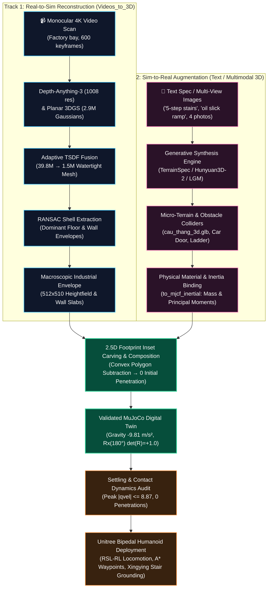
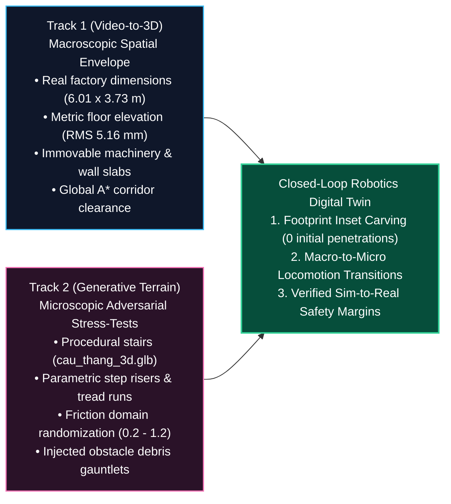
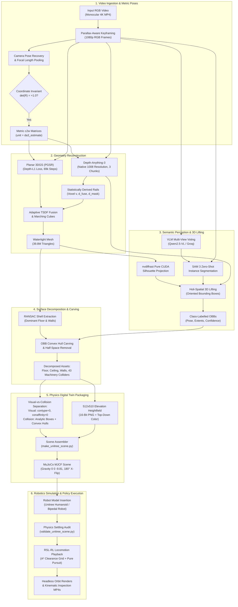

# Video-to-Terrain

Monocular video reconstruction, terrain extraction, and MuJoCo simulation.

[](https://www.python.org/)
[-EE4C2C?logo=pytorch&logoColor=white)](https://pytorch.org/)
[](https://mujoco.org/)
[-76B900?logo=nvidia&logoColor=white)](https://www.nvidia.com/)
[](LICENSE)
[](tests/)

> **Research Portfolio & Technical Implementation**<br/>
> Prepared for the **Digital Twin, Robotics, and Smart Manufacturing Research Assistant** position at **VinUniversity**.<br/>
> Primary benchmark: Industrial factory reconstruction (`small_factory`, 600 keyframes, $6.01 \times 3.73 \times 6.35\,\text{m}$ envelope) deployed with the **Unitree Humanoid / Bipedal Robot** model and RSL-RL reinforcement learning locomotion policies.

**Scale provenance:** reconstruction coordinates remain DA3 estimates until a physical reference calibrates them with `--metres-per-unit`. Reported scene dimensions and physics results below describe a recorded run; they do not establish ground-truth metric accuracy.

Large meshes, generated MJCF scenes, and the full presentation bundle are local artifacts excluded from Git. Paths to those artifacts appear as inline code; links to repository files refer to tracked content.

- [Setup](#prerequisites--reproducibility-guide)
- [Architecture](#dual-track-digital-twin-architecture-real-to-sim--sim-to-real-synthesis)
- [Demos and media](#interactive-demos--visual-evidence-showcase)
- [Run the pipeline](#step-by-step-execution-guide)
- [Documentation](#documentation-index)

---

## Technical Overview

**Video-to-Terrain** (Python package: `v3d`; local checkout also named `Videos_to_3D`) transforms monocular RGB video scans into semantically labelled 3D environments, terrain heightfields, and [MuJoCo](https://mujoco.org/) scenes. Physical scale requires reference calibration.

Rather than terminating at photorealistic novel view synthesis or raw unsegmented triangle soups, this system treats 3D computer vision and generative geometry as the unified foundation for **rigid-body robotics simulation, traversability analysis, and cyber-physical operations**. The system operates across a **Dual-Track Digital Twin Architecture**:

- **Track 1: Video-to-3D (Real-to-Sim Reconstruction)**: Automates the transformation of unconstrained monocular 4K RGB video scans into metric, semantically grounded digital twins with $512 \times 510$ elevation heightfields, analytical boundary colliders, and isolated machinery bodies.
- **Track 2: Text-to-Terrain & Multimodal Generative 3D (Sim-to-Real Augmentation)**: Procedurally synthesizes parametric stairs, inclines, fractal micro-roughness, and diffusion-generated 3D machinery assets from natural language prompts or multi-view images to stress-test bipedal robot locomotion and manipulation policies.

---

## Dual-Track Digital Twin Architecture: Real-to-Sim & Sim-to-Real Synthesis

Robotic reinforcement learning (RL) policies and model-predictive controllers deployed in cyber-physical environments face two conflicting engineering requirements:

1. **Macroscopic Physical Authenticity (Real-to-Sim)**: The robot must navigate the genuine metric geometry, floor elevations, boundary walls, and immovable machinery layouts of the physical facility.
2. **Microscopic Adversarial Diversity (Sim-to-Real)**: If the robot is trained or certified exclusively inside nominal, flat scanned rooms, the policy overfits to benign conditions and catastrophically fails when encountering unmodeled terrain variations (staircases, ramps, ground clutter, or slippery catwalks).

To reconcile these requirements, this system establishes a **Dual-Track Digital Twin Architecture** uniting passive monocular video reconstruction with active procedural/multimodal generative 3D synthesis:



### Track 1: Video-to-3D (Real-to-Sim Reconstruction) — Macroscopic Industrial Spatial Envelope

Track 1 reconstructs real-world operational environments directly from commodity monocular RGB video without relying on LiDAR hardware or manual CAD drafting.

- **Camera Trajectory & Focal Invariance**: Pools focal length estimates across non-zooming keyframes and checks camera extrinsics $c2w$ for strict chirality preservation ($\det(R) = +1.0 \pm 10^{-5}$).
- **High-Density Foundation Depth**: Executes [Depth-Anything-3](https://arxiv.org/abs/2511.10647) at native 1008 resolution (200 views per chunk). This limits scale drift across sequential chunks to $0.11\%$ (compared with $6\%\text{--}27\%$ in the alternative chunking configurations recorded for this project).
- **Surface-Constrained Geometry**: Depth-L1 supervised Planar 3DGS (PGSR) scales from 616k to 2.9M surface Gaussians ($24.80\,\text{dB}$ PSNR), while adaptive TSDF volumetric fusion dynamically bounds voxel size ($v = \operatorname{clamp}(1.75 \cdot d_{\text{med}}/f, D_{\text{scene}}/6000, D_{\text{scene}}/2500)$) to yield a 39.8M triangle mesh decimated to 1.5M watertight faces (`room_1500k.glb`).
- **Semantic Architectural Segregation**: RANSAC plane fitting extracts the dominant factory floor ($\text{verticality} > 0.99$, surface RMS error $= 5.16\,\text{mm}$) and boundary wall slabs. Zero-shot SAM 3 and Holi-Spatial 3D bounding box (OBB) lifting segregate 43 independent machinery and equipment colliders.
- **Physics Packaging**: Visual meshes are assigned `contype="0" conaffinity="0" group="2"`. Collisions are discretized into a $512 \times 510$ 16-bit elevation heightfield (`heightfield.png`, `height_map.npy`), explicit analytical wall `<box>` colliders with door openings, and rigid equipment hulls.

**Primary Role**: Establishes the reconstructed spatial envelope, boundary limits, global navigation aisles ($r_{\text{robot}} = 0.45\,\text{m}$ clearance after calibration), and nominal support surface for robotics simulation.

### Track 2: Text-to-Terrain & Multimodal Generative 3D (Sim-to-Real Augmentation)

The procedural `TerrainSpec` generator and mocap stair fitting belong to the companion `Images_to_terrain/terrain3d-app` project. They are integration examples, not modules included in this checkout. This repository provides mesh-to-heightfield export in [`src/v3d/export/terrain.py`](src/v3d/export/terrain.py) and the [Hunyuan3D adapter](docs/guides/holispatial-hunyuan3d-adapter.md).

Track 2 actively synthesizes procedural terrains, parameterized staircases, obstacle gauntlets, and physical object assets from natural language prompts, parameter ranges, or sparse multi-view photographs.

#### Text-to-Terrain & Procedural Heightfield Generation

Driven by the structured `TerrainSpec` schema (`core/schemas/terrain_spec.py`), the generator synthesizes deterministic, seeded 2.5D elevation heightmaps $\mathcal{H}(x, y)$ spanning $[-W/2, W/2] \times [-L/2, L/2]$:

- **Parametric Staircase Synthesis**: Analytical step plateaus are carved via `_add_stairs(h, ...)`:

  ```math
  \mathcal{H}_{\text{stairs}}(x, y) = \begin{cases}
  z_{\text{base}} + \min\left(K, \left\lfloor \frac{x - x_0}{d_{\text{step}}} \right\rfloor + 1\right) \cdot h_{\text{step}} & \text{if } x_0 \le x < x_0 + K \cdot d_{\text{step}} \text{ and } |y - y_0| \le \frac{W_{\text{stair}}}{2} \\
  z_{\text{landing}} & \text{if } x \ge x_0 + K \cdot d_{\text{step}} \text{ and } |y - y_0| \le \frac{W_{\text{stair}}}{2} \\
  z_{\text{base}} & \text{otherwise}
  \end{cases}
  ```

  where step riser $h_{\text{step}} \in [0.05, 0.22]\,\text{m}$, tread run $d_{\text{step}} \in [0.20, 0.35]\,\text{m}$, and $K$ is step count.
- **Multi-Fractal Roughness & Inclines**: Octave-summed 2D value noise simulates industrial concrete wear and micro-roughness:

  ```math
  \mathcal{H}_{\text{roughness}}(x, y) = \sum_{k=0}^{O-1} \frac{1}{2^k} \cdot \text{ValueNoise}_{2\text{D}}\left(2^k f_0 x, \; 2^k f_0 y\right)
  ```

  combined with continuous planar slopes ($\theta_{\text{slope}} \in [-45^\circ, +45^\circ]$).
- **Physical Contact Parameterization**: Emits surface friction coefficients ($\mu \in [0.2, 1.2]$), restitution damping, and constraint impedance (`solref="0.01 1.0"`, `solimp="0.9 0.95 0.001 0.5 2"`).

#### Multimodal Generative 3D Asset Synthesis (Hunyuan3D-2 / LGM / MVDream)

For discrete obstacle entities and complex machinery (stairs, ladders, barrels, machinery housings), Track 2 accepts natural language prompts, single orbit videos, or 4 orthogonal photographs (front, right, back, left):

- **Diffusion Shape & Texture**: Generates 3D shape latents via Hunyuan3D-2mv and bakes surface albedo via Hunyuan3D-Paint.
- **Conditioning Pipeline**: Normalizes coordinates $\to$ closes non-manifold boundaries $\to$ applies quadric mesh decimation $\to$ performs convex hull decomposition (Trimesh / V-HACD) for collision geometries.
- **Physical Mass & Inertia Tensor Calculation**: Rather than guessing inertial parameters, mass $m = \rho_{\text{mat}} \cdot V \cdot (1 - \phi_{\text{hollow}})$ is computed from calibrated material densities (`physics/materials.yaml`). Exact principal moments of inertia $\mathbf{I} = \operatorname{diag}(I_{xx}, I_{yy}, I_{zz})$ are derived via `to_mjcf_inertial()`, preventing unphysical rotational acceleration in MuJoCo.
- **Real Generated Deliverables**:
  - **Procedural / Generative Staircases**: `cau_thang_3d.glb` ($31.8\,\text{MB}$), `cau_thang_turntable.mp4`, and decimated variant `cau_thang_4view_v2.glb` ($6.7\,\text{MB}$).
  - **Physics-Validated Objects**: Industrial ladder ($11.78\,\text{kg}$ aluminum, hollow 0.977), car door ($19.94\,\text{kg}$ steel, hollow 0.9906), tire ($9.00\,\text{kg}$ sidewall spec), plastic crate ($2.51\,\text{kg}$ HDPE), workbench (`obj_0179_workbench.glb`), turbine blade (`obj_0202_blade.glb`), and workshop receptacle (`obj_0203_trash_can.glb`).

#### Motion-Terrain Grounding (Mocap Alignment & Stair Fitting)

- **The Classical Failure**: Motion capture datasets (e.g. human stair climbing in the Xingying CT22 dataset) record joint kinematic trajectories in empty space without recording the physical stairs. Directly evaluating bipedal policies on ungrounded mocap causes foot floating, unnatural step extensions, and phantom forces.
- **The Engineering Solution**: As demonstrated in [`comparison_xingying_ct22_stairs.mp4`](output/REPORT/media/comparison_xingying_ct22_stairs.mp4) and implemented in `pipeline/mocap/stairs_fit.py`, the system clusters upward-facing surface normals ($\mathbf{n} \cdot \mathbf{u}_z > 0.94$) to identify discrete tread levels and solves for metric scale:

  ```math
  \text{scale} = \frac{\Delta z_{\text{riser, mocap}}}{\Delta z_{\text{riser, mesh}}}
  ```

  Grounding the motion sequence onto the generated staircase establishes authentic normal contact reaction forces and prevents foot-penetration artifacts.

### Complementary System Logic: Why the Closed Loop Is Essential

The two tracks form a symbiotic, closed-loop robotics engineering workflow:



1. **Macro-Envelope Grounding vs. Micro-Hazard Diversity**:
   - Track 1 anchors the global factory layout: room boundaries, metric clearances, door traversability, and primary robot walking paths.
   - Track 2 injects parametric hazards into the traversable clearings: an RL agent can navigate the authentic factory corridor and transition onto a procedurally generated 5-step industrial staircase (`cau_thang_3d.glb`) to stress-test bipedal balance.
2. **2.5D Rasterization & Non-Interference Footprint Carving**:
   - *The Danger*: Placing a Track 2 generated asset directly on top of Track 1's heightfield causes 100+ penetrating contact pairs due to floor scanner roughness ($\pm 15\,\text{mm}$), blowing up the MuJoCo solver ($\lvert q_{\text{vel}} \rvert \sim 48.8$).
   - *The Solution*: As implemented in [`scripts/sim/make_unitree_scene.py`](scripts/sim/make_unitree_scene.py), the 2D bounding polygon of the generated asset is projected onto the host heightfield. Heightfield cells inside the footprint are carved down to base floor elevation ($z = 0$). The generated asset is then spawned with its convex collision hull resting on the floor. Initial contact penetrations drop to $0\,\text{mm}$ and peak generalized settling velocities stay strictly bounded ($\lvert q_{\text{vel}} \rvert \le 8.87$).
3. **Closing the Loop for Sim-to-Real Locomotion**:
   - A humanoid policy trained only on smooth flat ground fails when encountering uneven industrial grating or stairs.
   - By fusing Track 2's parametric terrain curriculum into Track 1's authentic spatial twin, the robot is trained under domain randomization across both macroscopic aisle navigation and microscopic step negotiation.

### Data Interchange Formats & Simulation Physics Invariants

To eliminate data format mismatches across computer vision and physics solvers, the dual-track system standardizes on four strict mathematical representations:

| Format / Representation | File Types | Precision & Structure | Physics Engine Treatment | Repo Role |
| :--- | :--- | :--- | :--- | :--- |
| **Continuous 3D Mesh** | `.glb`, `.obj`, `.ply` | Watertight 2-manifold triangle mesh, UV albedo texture | Visual mesh only: `contype="0" conaffinity="0" group="2"`. Never used as concave collider! | Photorealistic rendering, camera simulation, and WebGL inspection (`room_1500k.glb`, `cau_thang_3d.glb`). |
| **2.5D Elevation Heightfield** | `.npy`, 16-bit grayscale `.png` | Raw `float32` meter grid ($512 \times 510$) & 16-bit PNG normalized to $[0, 65535]$ | Discretized MuJoCo `<hfield>` collider: $O(1)$ cell contact lookup, analytical normal computation, zero contact chatter. | Ground elevation representation (`heightfield.png`, `height_map.npy`), terrain carving substrate. |
| **Analytical Primitives** | MJCF `<box>`, `<cylinder>` | Half-extents $[s_x, s_y, s_z]$ in meters | Exact GJK-EPA analytical collision detection, infinite surface smoothness, zero edge snagging. | Boundary wall slabs, door jambs, stair treads, and geometric obstacles. |
| **Convex Hull Rigid Bodies** | MJCF `<geom type="mesh">` | Decimated convex hulls ($< 2\,000$ faces), principal moments $\mathbf{I}$ | Rigid body dynamics: full 6-DoF inertia tensor, Newton-Euler integration, friction cone modeling. | Discrete machinery assets (43 factory colliders, workbenches, crates, tools). |

MuJoCo heightfield sizing contract:

```xml
<asset>
  <!-- size: half-length-X  half-length-Y  height-span-Z  base-depth -->
  <hfield name="terrain" file="heightfield.png" nrow="512" ncol="510"
          size="3.005000 1.865000 0.850000 0.050000"/>
</asset>
```

Heights in meters are mapped linearly:

```math
z(u, v) = z_{\min} + \frac{P_{16}(u, v)}{65535} \cdot \left(z_{\max} - z_{\min}\right)
```

---

## Interactive Demos & Visual Evidence Showcase

To facilitate thorough technical evaluation by researchers, faculty, and committee members at **VinUniversity**, this repository provides pre-compiled WebGL/Three.js interactive digital twin viewers, dynamic in-browser physics simulations, procedural terrain and stair curriculum synthesizers, and recorded simulation telemetry.

### Reviewer Quick-Start: Inspecting Demos Locally

The report HTML pages and selected media are checked in. Their full 3D assets must be supplied from the corresponding delivery bundle before the viewers can load them. `output/Twin_Data_Presentation/` and the full-factory contact sheet also require that local bundle.

Because WebGL/Three.js applications load binary 3D meshes (`.glb`) and metadata via JavaScript Fetch APIs, modern web browsers enforce CORS restrictions when opening files via `file://`. Reviewers can inspect the complete deliverable suite via Python's lightweight HTTP server or the Makefile targets:

```bash
# Serve the tracked report pages and available media:
python3 -m http.server 8790 --directory output/REPORT

# With the full local presentation bundle available:
make presentation-serve
```

Once running, navigate directly to any of the local interactive interfaces:

| Interface & Interactive Mode | Local Browser URL | Research Purpose & Demonstration Capabilities | File Link |
| :--- | :--- | :--- | :--- |
| **Twin Digital Data Presentation & Turntables** | [`http://127.0.0.1:8080/index.html`](http://127.0.0.1:8080/index.html) | Interactive 8-stage slide deck with embedded video turntables, Xingying CT22 stairs comparison, Hunyuan3D object previews, and procedural staircase model. | `output/Twin_Data_Presentation/index.html` |
| **Interactive Web 3D Physics Viewer** | [`http://127.0.0.1:8790/viewer/index.html`](http://127.0.0.1:8790/viewer/index.html) | Real-time BVH collision raycasting, drag-and-drop 8 isolated rigid objects, freefall gravity dynamics, kinetic impact energy readout. | [`output/REPORT/viewer/index.html`](output/REPORT/viewer/index.html) |
| **Full Factory 38-Object Interactive Tour** | [`http://127.0.0.1:8790/full_factory/index.html`](http://127.0.0.1:8790/full_factory/index.html) | 13-slide interactive presentation deck showcasing large-scale factory reconstruction ($6.01 \times 3.73 \times 6.35\,\text{m}$), 38 segmented assets, manipulation classification. | [`output/REPORT/full_factory/index.html`](output/REPORT/full_factory/index.html) |
| **Twin Digital Data Master Report** | [`http://127.0.0.1:8790/index.html`](http://127.0.0.1:8790/index.html) | Comprehensive interactive slide deck covering all 8 stages, LiDAR/CAD trade-off benchmarks, failure mode resolutions. | [`output/REPORT/index.html`](output/REPORT/index.html) |
| **Completed 3D Objects Inspection (360°)** | [`http://127.0.0.1:8790/objects3d/index.html`](http://127.0.0.1:8790/objects3d/index.html) | Google `<model-viewer>` 3D orbital inspection, 360° turntable videos, and 4-view orthographics for Hunyuan3D completed assets. | [`output/REPORT/objects3d/index.html`](output/REPORT/objects3d/index.html) |
| **Factory 38-Asset Contact Sheet** | [`http://127.0.0.1:8790/full_factory/media/full_factory_contact_sheet.html`](http://127.0.0.1:8790/full_factory/media/full_factory_contact_sheet.html) | Orthogonal photographic contact sheet tracking completion state across all 38 factory machinery and tool entities. | `output/REPORT/full_factory/media/full_factory_contact_sheet.html` |

To launch the native desktop [MuJoCo](https://mujoco.org/) graphical viewer or execute the automated physics validation suite:

```bash
# Launch interactive MuJoCo GUI with the reconstructed factory scene and Unitree humanoid:
make room-view ROOM_OUT=outputs-full-factory/delivery/OUTPUT_ROOM

# Audit an existing factory heightfield export (separate from room_scene.xml):
.venv/bin/python scripts/sim/validate_unitree_scene.py outputs-full-factory/robot_sim/mujoco
```

---

### Core Demonstrations & Technical Implementations

#### Interactive Web 3D Physics Viewer

- **Deliverable**: [`output/REPORT/viewer/index.html`](output/REPORT/viewer/index.html)
- **Technical Mechanism**:
  - Rather than displaying static pre-rendered animations, the viewer integrates a live in-browser rigid body dynamics solver built with Three.js and `three-mesh-bvh`.
  - **Bounding Volume Hierarchy (BVH) Acceleration**: Generates BVH bounding trees across the 1.5M triangle room mesh (`room_1500k.glb`) and machinery colliders, accelerating spatial ray queries to sub-millisecond rates.
  - **Continuous Contact Raycasting**: Downward raycast bundles originate from multi-point footbases (`feetOf`) on each object, continuously detecting the nearest support geometry (e.g., differentiating between the concrete floor and the surface of `obj_0179_workbench`).
  - **Dynamic Settling & Energy Dissipation**: Computes Newtonian freefall under gravity $g = 9.81\,\text{m/s}^2$, quadratic atmospheric drag $F_d = \frac{1}{2}\rho C_d A v^2$, and restitution $\varepsilon = 0.12$.
  - **Interactive Controls**: Users can click, drag, and lift 8 extracted factory equipment pieces (`obj_0179_workbench`, `obj_0202_blade`, `obj_0203_trash_can`, metal crates, machinery parts). A live telemetry panel reports kinetic energy dissipation (Joules), instantaneous velocity ($\text{m/s}$), and clearance above supporting surfaces.

#### Full Factory 38-Object Interactive Tour

- **Deliverable**: [`output/REPORT/full_factory/index.html`](output/REPORT/full_factory/index.html)
- **Technical Mechanism**:
  - A 13-slide interactive showcase documenting the reconstruction of the entire industrial facility envelope ($6.01 \times 3.73 \times 6.35\,\text{m}$).
  - **Robotic Manipulation Classification**: Categorizes all 38 extracted physical entities into robotic kinematic roles:
    - `DYNAMIC_LIFTABLE` ($< 15\,\text{kg}$): Tooling, cutting blades, containers, loose storage bins eligible for robot arm grasp planning and pick-and-place manipulation.
    - `STATIC_OBSTACLE` ($> 100\,\text{kg}$): Heavy workbenches, CNC machinery housings, storage racks, and access ladders serving as rigid spatial barriers.
  - **Multi-View Coverage Gating**: Evaluates camera azimuth coverage. For partially occluded equipment, [Hunyuan3D 2.0](https://arxiv.org/abs/2501.12202) completes unseen backsides into watertight meshes verified against multi-view silhouette IoU.

#### Text-to-Terrain & Procedural Stairs Demo (Detailed Technical Logic)

- **Deliverables**: [`src/v3d/export/terrain.py`](src/v3d/export/terrain.py), [`docs/guides/text-to-terrain-integration.md`](docs/guides/text-to-terrain-integration.md), [`scripts/tools/export_blender.py`](scripts/tools/export_blender.py), and Case Study [`output/REPORT/media/comparison_xingying_ct22_stairs.mp4`](output/REPORT/media/comparison_xingying_ct22_stairs.mp4)
- **Motivation & Problem Formulation**:
  In reinforcement learning for legged robotics (e.g. Unitree H1/G1 bipedal humanoids), training exclusively on flat ground meshes yields fragile policies that stumble or fail when encountering real-world irregularities. Sim-to-real policy transfer demands curriculum learning across structured, parameterized variations in elevation, stair risers, slope angles, and surface roughness.
- **The Text-to-Terrain & Procedural Synthesis Logic**:
  1. **Generative Parameterization**: From natural language prompts or curriculum configuration scripts (e.g., *"industrial access stairwell with 18 cm risers and 28 cm treads"*), the pipeline parameterizes terrain into analytical heightfield matrices $\mathcal{H}(x, y)$.
  2. **Mathematical Formulation of Procedural Stairs**:
     For a flight of stairs with step riser height $h \in [0.05, 0.22]\,\text{m}$, tread run depth $d \in [0.20, 0.35]\,\text{m}$, total steps $K$, width $W$, and origin $(x_0, y_0)$:

     ```math
     \mathcal{H}_{\text{stairs}}(x, y) = \begin{cases}
     z_{\text{base}} + \min\left(K, \left\lfloor \frac{x - x_0}{d} \right\rfloor + 1\right) \cdot h & \text{if } x_0 \le x < x_0 + K \cdot d \text{ and } |y - y_0| \le \frac{W}{2} \\
     z_{\text{landing}} & \text{if } x \ge x_0 + K \cdot d \text{ and } |y - y_0| \le \frac{W}{2} \\
     z_{\text{base}} & \text{otherwise}
     \end{cases}
     ```

  3. **High-Frequency Multi-Fractal Roughness**:
     Simulates realistic concrete degradation and micro-relief through octave-summed noise:

     ```math
     \mathcal{H}_{\text{terrain}}(x, y) = \mathcal{H}_{\text{base}}(x, y) + \sum_{i=1}^{M} \frac{A_0}{2^i} \cdot \text{Noise}\left(2^i f_0 x, \; 2^i f_0 y\right)
     ```

  4. **Surface Sampling & Poisson Void Elimination**:
     Standard vertex rasterization leaves flat surfaces sparse and curved objects dense, leaving $58\%$ of terrain cells empty (creating phantom pit hazards). As implemented in [`TerrainPolicy`](src/v3d/export/terrain.py#L46), the system samples points uniformly from the mesh *surface* proportional to grid dimensions:

     ```math
     N_{\text{samples}} = \operatorname{clamp}\left(N_u \cdot N_v \cdot S_{\text{cell}}, \; 200\,000, \; 24\,000\,000\right), \quad S_{\text{cell}} = 16
     ```

     Under a uniform occupancy approximation, $S_{\text{cell}} = 16$ gives an expected Poisson empty-cell fraction of $e^{-16} < 1.13 \times 10^{-7}$. Actual coverage depends on the mesh; remaining holes are reported and filled.
  5. **Traversability Analysis & Curriculum Distributions**:
     Locomotion curriculum generation requires distribution tails rather than simple scalar means. The pipeline computes:
     - **Slope Stride ($\Delta s = 3$)**: Evaluates gradients over robot-scale baselines ($\approx 3.5\,\text{cm}$ after calibration) rather than high-frequency noise.
     - **Step Radius ($r = 2$)**: Detects maximum step discontinuity in local rings: $\Delta h_{\text{step}} = \max_{\mathcal{N}_r} |\Delta \mathcal{H}|$.
     - **Distribution Tail**: Emits exact percentiles $(P_{50}, P_{75}, P_{90}, P_{95}, P_{99}, P_{100})$. For example, $P_{95} = 18\,\text{cm}$ sets the upper threshold of the robot curriculum, while $P_{50} \le 5^\circ$ confirms that $50\%$ of the room is traversable without special gait adaptation.
  6. **The Xingying CT22 Staircase Benchmark**:
     - *The Failure Mode*: The Xingying motion capture benchmark captures human and bipedal walking motions, but distributes trajectories *decoupled from environment geometry*. In simulation, policies trained on motion alone appear valid in mid-air, but fail immediately when deployed onto physical steps due to missing contact reaction normals.
     - *The Solution*: As showcased in [`comparison_xingying_ct22_stairs.mp4`](output/REPORT/media/comparison_xingying_ct22_stairs.mp4), our pipeline attaches precise, watertight stair geometry (reconstructed stair GLBs + procedural steps) to the motion sequence, establishing explicit foot-ground contact mechanics and verifiable sim-to-real ground reaction forces.

#### Bipedal Robot Locomotion Playback

- **Deliverables**: `output/REPORT/twindata/media/walk_tour.mp4`, [`scripts/sim/walk_tour.py`](scripts/sim/walk_tour.py), and `outputs-full-factory/delivery/OUTPUT_ROOM/room_scene.xml`
- **Technical Mechanism**:
  - Demonstrates closed-loop autonomous locomotion of the Unitree humanoid robot model traversing the reconstructed factory floor.
  - **Clearance Grid Generation**: Rasterizes all 43 extracted equipment bounding boxes into a 2D occupancy grid and applies morphological dilation with robot radius $r_{\text{robot}} = 0.45\,\text{m}$.
  - **A* Waypoint Pathfinding**: Computes optimal collision-free trajectories between inspection waypoints across factory aisles.
  - **Pure Pursuit & RSL-RL Policy Execution**: Runs an exported neural network locomotion policy (`policy_12000.onnx`) at $50\,\text{Hz}$. A pure pursuit controller calculates target heading and converts lookahead errors into commanded velocity vectors $[v_x, v_y, \omega_z]^T$.
  - **Physics Settling & Contact Stability**: Audited with zero initial penetrations ($> 5\,\text{mm}$), terrain heightfield surface RMS error of $5.16\,\text{mm}$ against dense point clouds, and a settling velocity $\lvert q_{\text{vel}} \rvert = 8.87$.

---

### Delivered Video Evidence & Turntables Catalog

Four clips below are tracked in [`output/REPORT/media/`](output/REPORT/media/): the stairs comparison, scene manipulation, heading test, and RGB-D capture gap. Other entries describe the full local delivery bundle and are shown as paths rather than download links.

| Demonstration Media | File Path | Resolution / Duration | Scientific Purpose & Evidence Provided |
| :--- | :--- | :--- | :--- |
| **Xingying CT22 Stairs Motion vs. Terrain** | [`output/REPORT/media/comparison_xingying_ct22_stairs.mp4`](output/REPORT/media/comparison_xingying_ct22_stairs.mp4) | $1920 \times 720$ (5.5s) | Demonstrates why ungrounded motion capture data fails in robotics, and proves the necessity of grounding bipedal motion with reconstructed/procedural stair geometry. |
| **Interactive Use Case: Dynamic Scene Manipulation** | [`output/REPORT/media/usecase_move_around.mp4`](output/REPORT/media/usecase_move_around.mp4) | $1920 \times 1080$ (30.0s) | Demonstrates interactive reconfiguration of extracted 3D factory objects (drag, collision response, customizable warehouse digital twin creation). |
| **Autonomous Navigation Heading Test (270°)** | [`output/REPORT/media/heading_270.mp4`](output/REPORT/media/heading_270.mp4) | $1920 \times 1080$ (8.2s) | Bipedal robot navigation along $270^\circ$ vector ($3.49\,\text{m}$ trajectory, maintaining upright stability metric of $0.87$). |
| **RGB-D Sensor Scanning Occlusion Gap** | [`output/REPORT/media/rgbd_capture_gap.mp4`](output/REPORT/media/rgbd_capture_gap.mp4) | $1280 \times 720$ (4.0s) | Documents physical scanning occlusions and validates our quantitative coverage gating before multi-view 3D diffusion completion. |
| **Bipedal Robot Locomotion Tour (MuJoCo)** | `output/REPORT/twindata/media/walk_tour.mp4` | $1920 \times 1080$ (15.0s) | Full closed-loop walking execution of the Unitree humanoid robot traversing waypoints on the reconstructed factory terrain. |
| **Raw Monocular Video Input Scan** | `output/REPORT/media/01_dau_vao_video.mp4` | $3840 \times 2160$ (12.0s) | Benchmark source video: 600 keyframes captured handheld in an unconstrained industrial environment. |
| **Foundation Metric Depth Estimation** | `output/REPORT/media/02_do_sau_da3.mp4` | $1920 \times 1080$ (10.0s) | Native 1008-resolution Depth-Anything-3 depth inference suppressing scale drift to $0.11\%$. |
| **3D Gaussian Splatting (PGSR)** | `output/REPORT/media/03_gaussian_splatting.mp4` | $1920 \times 1080$ (12.0s) | Real-time radiance field rendering: 2,902,811 planar-regularized Gaussians achieving $24.80\,\text{dB}$ PSNR. |
| **Watertight 3D Mesh Surface** | `output/REPORT/media/04_mesh_3d.mp4` | $1920 \times 1080$ (12.0s) | 39.8M TSDF triangle mesh decimated to 1.5M watertight faces with vertex colors. |
| **Interior Architectural Cross-Section Cutaway** | `output/REPORT/media/05_cat_ngang_phong.mp4` | $1920 \times 1080$ (8.0s) | Architectural RANSAC decomposition separating floor and walls from internal workspace. |
| **Oriented 3D Bounding Boxes & Object Segregation** | `output/REPORT/media/06_hop_vat_the.mp4` | $1920 \times 1080$ (10.0s) | Holi-Spatial 3D OBB lifting and semantic labeling across 43 independent machinery colliders. |
| **Workbench 360° Turntable Video** | `output/REPORT/objects3d/obj_0179_workbench_turntable.mp4` | $1080 \times 1080$ (6.0s) | 360-degree turntable orbital spin of completed watertight workbench asset. |
| **Blade 360° Turntable Video** | `output/REPORT/objects3d/obj_0202_blade_turntable.mp4` | $1080 \times 1080$ (6.0s) | 360-degree turntable orbital spin of reconstructed industrial metal blade. |
| **Trash Can 360° Turntable Video** | `output/REPORT/objects3d/obj_0203_trash_can_turntable.mp4` | $1080 \times 1080$ (6.0s) | 360-degree turntable orbital spin of reconstructed workshop receptacle. |

---

## Core Differences: Why Computer Vision Fails Physics Simulation

Most 3D computer vision pipelines produce attractive visual meshes that cause immediate failures when loaded into physics engines like MuJoCo, Isaac Sim, or Bullet. This repository resolves five fundamental engineering hurdles:

| Engineering Challenge | Why Naive Vision Pipelines Fail | Video-to-3D Engineering Solution | Repo Reference |
| :--- | :--- | :--- | :--- |
| **1. Embedded Object Collision Explosion** | Photogrammetry and TSDF embed furniture and machines directly into the continuous ground mesh. Loading the raw mesh alongside object colliders generates 60+ penetrating collision pairs, contact forces $> 10^5\,\text{N}$, and peak velocities $\lvert q_{\text{vel}} \rvert \sim 48.8$, causing the physics solver to explode. | **OBB Convex Hull Projection & Terrain Carving**: Rasterises each object's 3D oriented box as a 2D convex polygon, subtracts the equipment footprint from the continuous heightfield down to floor level, and instantiates the equipment as an independent rigid collider. Initial contacts drop to zero and peak settling velocity drops to $\lvert q_{\text{vel}} \rvert = 8.87$. | [`scripts/sim/make_unitree_scene.py`](scripts/sim/make_unitree_scene.py) |
| **2. Doorways in 2.5D Heightfields** | Terrain heightmaps are single-valued functions $z = f(x, y)$. A heightfield cannot represent an undercut or tunnel; doorways and overhead machine arches become solid vertical barriers, making the room impassable. | **Wall Band Carving & Explicit Analytical Slabs**: Reconstructed wall bands are stripped from the heightfield down to ground elevation and replaced by explicit MuJoCo `<box>` primitives (lintel and jambs) placed at metric door locations, providing robot-passable openings verified across 3 clearance heights. | [`src/v3d/scene/decompose.py`](src/v3d/scene/decompose.py) |
| **3. Headless Offline GPU Runtime Crashes** | Running massive neural foundation models (DA3, SAM 3, PGSR) on remote offline GPU kernels (Kaggle Blackwell RTX PRO 6000) causes headless crashes due to missing X11/EGL displays, `bf16` tensor type mismatches, and host RAM limits. | **Pure CUDA Rasterizer & Chunked Host Streaming**: Bypassed `nvdiffrast` EGL by compiling a native sm_120 CUDA rasterizer context in 27 seconds; patched SAM 3 checkpoint tensors to handle multi-head weight layout; routed chunked DA3 tensors to CPU immediately to keep VRAM consumption strictly under 95 GiB. | [`docs/guides/kaggle-deployment.md`](docs/guides/kaggle-deployment.md) |
| **4. Monocular Scale Drift & Focal Invariance** | Uncalibrated monocular camera video lacks absolute scale. Naive high-resolution frame chunking produces 6% to 27% scale drift across sequential segments due to per-chunk Umeyama alignment instability. | **Focal Pooling & Multi-View DA3 1008**: Pools focal length estimates (rejecting zooms while taking the median of fixed lenses), processes 200 views per chunk at native 1008 resolution (slashing scale drift to 0.11%), and anchors absolute scale via RANSAC floor planes (`unit="da3_estimate"`, single-parameter calibration `--metres-per-unit`). | [`src/v3d/ingest/poses.py`](src/v3d/ingest/poses.py) |
| **5. Closed-Loop Locomotion & Physics Settling** | Standard 3D repos stop at rendering turntable MP4s. Simulators require valid mass matrices, proper coordinate frame chirality ($\det(R) = +1$), and settling stability under gravity. | **Unitree Humanoid Integration & RSL-RL Policy Playback**: Implements $180^\circ$ rotation around X to align $-Z$ gravity without mirroring; resolves dual-freejoint kinematic root offsets; executes trained ONNX walking policies via A* pathfinding and pure pursuit steering. | [`scripts/sim/walk_tour.py`](scripts/sim/walk_tour.py) |

---

## Motivation & Objectives

### The Industrial Bottleneck

Modern smart manufacturing facilities and cyber-physical systems demand high-fidelity digital twins for autonomous robot navigation, predictive asset maintenance, automated guided vehicle (AGV) routing, and safe sim-to-real reinforcement learning. However, current industrial practice faces a steep tradeoff:

- **Terrestrial LiDAR & Multi-Rig Photogrammetry**: Prohibitively expensive ($>\$50\text{k}$ per scanner), slow to mobilize, and unable to extract semantic object boundaries automatically.
- **Manual CAD Modeling**: Requires hundreds of manual engineering hours per factory bay and rapidly desynchronizes from actual shop-floor state (workpieces moved, temporary partitions added).
- **Consumer Monocular Video**: Readily available via quadcopters, inspection crawlers, or factory floor technicians using smartphones, but traditionally dismissed as insufficient for metric physics simulation.

### Research Objectives

This project bridges the gap between foundation computer vision and robotic manipulation/locomotion:

1. **Democratize Digital Twin Creation**: Synthesize complete, topologically structured simulation scenes directly from commodity RGB video without external markers or specialized sensor rigs.
2. **Bridge Semantic Perception and Contact Mechanics**: Integrate open-vocabulary vision-language models (VLMs) and promptable segmentation (SAM 3) with oriented 3D bounding box estimation, enabling physical interaction with discrete objects rather than monolithic environment geometry.
3. **Sim-to-Real Deployment in MuJoCo**: Guarantee that reconstructed terrains and obstacles satisfy strict numerical stability criteria (zero initial penetration, finite generalized velocity vectors, realistic ground contact impedance) for bipedal humanoids and legged robots.
4. **Direct Alignment with VinUniversity Research**: Provides an operational testbed for smart manufacturing automation, digital twin infrastructure, autonomous inspection, and robot-environment interaction.

---

## End-to-End System Architecture

The complete dataflow transforms raw RGB video frames into a validated MuJoCo simulation containing terrain heightmaps, segmented obstacles, and an active robot policy:



---

## Key Implemented Features

### Metric 3D Depth & Reconstruction

- **Foundation Depth at Scale**: Deploys [Depth-Anything-3](https://arxiv.org/abs/2511.10647) at native 1008 resolution using 200 views per chunk. This preserves high-frequency structural details while keeping scale drift across sequential chunks to $0.11\%$ (compared to $6\%\text{--}27\%$ drift observed when chunking at 1920 with 20 sub-chunks).
- **Depth-Supervised Planar 3DGS**: Embeds PGSR surface regularizers with explicit depth-L1 supervision (`kernel_pgsr.py`). Point counts scale from an initial sparse 616k up to 2,902,811 surface Gaussians over 69,000 optimization steps, achieving 24.80 dB PSNR on industrial geometry.
- **Statistically Derived Quality Rails**: Implements dynamic derivation of voxel dimensions and truncation thresholds in [`src/v3d/geometry/quality.py`](src/v3d/geometry/quality.py). Voxel size is bounded by camera focal length and scene depth diagonal:

  ```math
  v = \operatorname{clamp}\left(1.75 \cdot \frac{d_{\text{med}}}{f}, \; \frac{D_{\text{scene}}}{6000}, \; \frac{D_{\text{scene}}}{2500}\right)
  ```

  This guarantees that large factory floors (spanning tens of meters) receive balanced memory allocation while preserving sub-centimeter geometric features.

### Multi-View Semantic Tagging & 3D Bounding Box Lifting

- **Promptable 2D-to-3D Lifting**: Combines SAM 3 zero-shot segmentation masks with multi-view VLM voting to detect and label objects across unconstrained viewpoints.
- **Holi-Spatial 3D OBB Estimation**: Back-projects 2D masks across depth fields to generate oriented 3D bounding boxes (OBBs) containing 3D centroid coordinates, 3D metric extents, orientation quaternions, and semantic labels.
- **Object Completion Bridge (Hunyuan3D-2mv)**: When equipment is scanned only from the front aisle (leaving back surfaces unobserved), an azimuth coverage gate triggers multi-view 3D diffusion completion via [Hunyuan3D 2.0](https://arxiv.org/abs/2501.12202), scoring candidates via silhouette IoU and depth error:

  ```math
  \text{Score} = \text{IoU}_{\text{silhouette}} - \lambda \cdot \text{Error}_{\text{depth}}
  ```

### Surface Decomposition & Obstacle Carving

- **RANSAC Plane Extraction**: Fits dominant planar surfaces to isolate structural architecture:
  - Floor plane: verticality $> 0.99$, horizontal span $> 95\%$.
  - Wall planes and ceiling boundaries: extracted with boundary guard thresholds (`max_shell_edge_frac = 0.10`) preventing the accidental deletion of interior safety guards or machine columns.
- **Half-Space Boundary Removal**: Eliminates exterior wall thickness artifacts while bounding plane removal fractions ($\le 45\%$ per plane, $\le 90\%$ total).
- **Connected Component Clustering**: Extracts 43 isolated 3D machinery meshes from the non-structural interior, allowing individual factory machines, workbenches, ladders, and storage racks to be moved, swapped, or manipulated.

### Physics-Ready Digital Twin Generation

- **Strict Visual-vs-Collision Separation**: MuJoCo treats all imported mesh geometries as solid convex hulls. Loading a non-convex factory room as a single collision mesh turns the interior into a solid block, ejecting any spawned robot. The pipeline separates geometry into:
  - Visual layers: `contype="0"`, `conaffinity="0"`, `group="2"`.
  - Collision layers: Analytical floor planes, primitive box colliders for walls, and convex-hull decimated machine components.
- **Coordinate System Chirality**: Monocular video reconstruction typically sets the camera origin with $+Z$ pointing into the floor. Inverting $Z$ directly creates a reflection ($\det = -1$), which mirrors robot kinematics. We apply a $180^\circ$ rotation around X:

  ```math
  R_{x, 180^\circ} = \begin{bmatrix} 1 & 0 & 0 \\ 0 & -1 & 0 \\ 0 & 0 & -1 \end{bmatrix}, \quad \det(R) = +1.0
  ```

  This aligns the gravity vector $\mathbf{g} = [0, 0, -9.81]^T$ downward while preserving robot right-handed coordinate frames.
- **Grid-Relative Heightfield Oversampling**: Computes $512 \times 510$ terrain elevation arrays with 16 samples per cell, reducing empty pit artifacts from $58\%$ to $0.18\%$.

### Bipedal & Humanoid Robot Integration

- **Unitree Humanoid / Bipedal Robot Integration**: Spawns the Unitree humanoid robot model directly into the reconstructed factory scene at its calibrated keyframe posture (`pelvis_z = 0.848` in the recorded scene).
- **Kinematic Root Offset Correction**: MuJoCo scenes containing both a movable environment base and a floating robot base instantiate two `freejoint` elements. The assembler automatically maps 35-DoF robot generalized positions ($q_{\text{pos}}$) to the secondary joint offset, preventing keyframe corruption.
- **RSL-RL Locomotion Playback**: Incorporates neural network locomotion policies trained via [RSL-RL](https://github.com/leggedrobotics/rsl_rl) (`policy_12000.onnx`). Locomotion is steered through:
  - A 2D clearance grid computed over obstacle footprints.
  - A* pathfinding through collision-free corridors ($r_{\text{robot}} = 0.45\,\text{m}$).
  - Pure pursuit path tracking adjusting forward and angular velocity commands $[v_x, v_y, \omega_z]^T$.

### Text-to-Terrain & Procedural Terrain Generation Logic

- **Implementation boundary**: [`src/v3d/export/terrain.py`](src/v3d/export/terrain.py) extracts heightfields and traversability statistics from meshes. [`scripts/tools/export_blender.py`](scripts/tools/export_blender.py) handles Blender export. Prompt-driven procedural generation belongs to the companion project described in the [integration guide](docs/guides/text-to-terrain-integration.md).
- **The Core Problem**: Visual 3D meshes (even at tens of millions of triangles) cannot be directly consumed by real-time locomotion RL policies without convex decomposition and structured terrain representations. Locomotion policies consume:
  1. A continuous 2.5D heightfield (elevation map) representing ground terrain.
  2. Statistically grounded traversability parameters (slopes, step heights, roughness).
  3. Strict physical parameter tags (`measured | derived | assumed`).
- **Surface Uniform Sampling vs. Vertex Density Bias**:
  - Vertex density clusters where geometric curvature is highest (e.g. machinery knobs have thousands of vertices while large flat concrete floors have few). Naive vertex sampling results in massive void holes across traversable floors.
  - [`height_map()`](src/v3d/export/terrain.py#L102) sizes the grid *first* ($512$ cells across) and then samples $N = \min(24\times 10^6, \max(200\,000, N_u \cdot N_v \cdot 16))$ uniformly distributed points from the mesh *faces*. The target is 16 samples per cell on average, subject to the total sample cap; individual cells can still be empty.
- **Traversability Distributions for Curriculum Learning**:
  - RL policy training cannot rely on simple scalar means (e.g., mean slope or average step height). Policies stumble on the extreme edges of terrain distributions.
  - [`traversability()`](src/v3d/export/terrain.py#L194) computes:
    - Gradient measured across `slope_stride = 3` cells (measuring tilt over robot-scale foot length rather than noise).
    - Step height within `step_radius = 2` cells ($\Delta h_{\text{step}} = \max |\Delta z|$).
    - Distribution percentiles: $P_{50}, P_{75}, P_{90}, P_{95}, P_{99}, P_{100}$. A curriculum is staged so that $P_{95} = 18\,\text{cm}$ sets the upper difficulty cap of a stair-climbing policy.
- **Physical Metadata Provenance Tracking**:
  - Every physical attribute is tagged with its provenance via [`PhysicsDefaults`](src/v3d/export/terrain.py#L79) (`floor_friction=0.9`, `restitution=0.05`, `density=300 kg/m^3`, `source="assumed"`). A policy relying on guessed friction is flagged explicitly before sim-to-real transfer to physical hardware.

---

## Industrial Benchmark: Small Factory Scene

The primary validation benchmark was executed on an unconstrained 4K handheld industrial scan (`small_factory_final.mp4`):

```text
================================================================================
                    BENCHMARK AUDIT: SMALL FACTORY TWIN
================================================================================
  Input Video:             600 keyframes extracted from 4K 60fps RGB scan
  Scene Bounding Volume:   6.01 m x 3.73 m x 6.35 m (Diagonal: 9.51 m, Height: 2.31 m)
  Dense Point Cloud:       8,000,000 points (XYZRGB, metric-scaled)
  Gaussian Splatting:      2,902,811 Gaussians @ 69k steps (PSNR: 24.80 dB)
  Raw Surface Mesh:        39,842,106 TSDF triangles (marching cubes)
  Decimated Delivery Mesh: 1,500,000 triangles (watertight, quadric decimated)
  Extracted Assets:        43 machinery colliders + 4 doors + 9 architectural planes
  Terrain Elevation Map:   512 x 510 grid (0.01183 m/cell), 0.18% void hole rate
--------------------------------------------------------------------------------
                         PHYSICS ENGINE SETTLING AUDIT
--------------------------------------------------------------------------------
  Spawn Position:          Flat interior corridor (clearance: 0.848 m)
  Initial Penetration:     0 contact pairs penetrating > 5 mm at t=0
  Terrain Surface RMS:     5.16 mm error on flat ground vs. reconstructed point cloud
  2-Second Settling Run:   Finite qpos/qvel confirmed; Peak |qvel| = 8.87 (stable)
  Doorway Traversal:       Clearance verified across 3 probe heights (0.25m, 0.9m, 1.6m)
  Policy Walking Test:     Unitree humanoid robot traversed 4 waypoints cleanly
================================================================================
```

---

## Technology Stack

| Domain | Framework / Library | Version / Target | Engineering Role |
| :--- | :--- | :--- | :--- |
| **Language** | Python | 3.11 used locally; package supports 3.10–3.13 | Core orchestration, pipelines, and CLI |
| **Deep Learning** | PyTorch / torchvision | Local pins in `requirements.txt`; recorded GPU runtime `2.10.0+cu128` | Neural network inference, tensor operations |
| **Depth Foundation** | Depth-Anything-3 | Giant/Large | Dense metric monocular depth estimation |
| **Segmentation** | Segment Anything 3 (SAM 3) | `sam3.pt` (1465 tensors) | Zero-shot promptable 2D instance masks |
| **3D Gaussian Splatting** | PGSR / Diff-Gaussian-Rasterization | Custom sm_120 build | Plane-regularized surface splatting |
| **Rasterization** | nvdiffrast | Pure CUDA context | Differentiable mesh-to-mask projection |
| **Geometry & Meshing** | Open3D, Trimesh, OpenCV | Local pins: `0.19.0`, `5.0.0`, `5.0.0.93` | TSDF fusion, RANSAC, decimation, GLB exports |
| **Physics Simulation** | MuJoCo | Local pin: `3.11.0` | Rigid body dynamics, collision contact modeling |
| **Locomotion Control** | RSL-RL / ONNX Runtime | Exported ONNX | Humanoid policy execution and waypoint pursuit |
| **Cloud GPU Infrastructure** | Jupyter Proxy Bridge | NVIDIA RTX PRO 6000 | Headless offline execution on Blackwell `sm_120` |

---

## Repository Layout

```text
Videos_to_3D/
├── README.md                           # Master research & technical documentation
├── AGENTS.md                           # Strict engineering invariants and quality rules
├── Makefile                            # Unified build, test, remote, and simulation targets
├── pyproject.toml                      # Package specifications for src/v3d
├── requirements.txt                    # Pinned, conflict-tested dependencies
│
├── src/v3d/                            # Core importable Python package
│   ├── config.py                       # Dataclasses: PipelineConfig, SceneLayout, scale modes
│   ├── manifest.py                     # Cryptographic run manifests and artifact hashing
│   ├── paper_runner.py                 # Multi-stage pipeline dispatcher and CLI (`v3d`)
│   ├── data/                           # Dataset loaders (ScanNet++, HuggingFace tars, Kaggle)
│   ├── ingest/                         # Video decoding, focal length pooling, pose geometry
│   ├── geometry/                       # Dynamic quality rails, PGSR configs, PyTorch3D shims
│   ├── semantic/                       # VLM prompt formatting, multi-view label voting
│   ├── scene/                          # RANSAC plane extraction, OBB decomposition, schemas
│   ├── export/                         # Watertight GLB, terrain heightfields, Blender tools
│   └── validate/                       # Physics audits, settling checks, GT box comparisons
│
├── scripts/                            # Executable scripts grouped by execution environment
│   ├── kernel/                         # Executes INSIDE the offline Kaggle GPU kernel
│   │   ├── kernel_stage.py             # Offline environment bootstrap and dependency checks
│   │   ├── kernel_da3_native.py        # Depth-Anything-3 inference with chunked host streaming
│   │   ├── kernel_pgsr.py              # Depth-supervised PGSR Gaussian Splatting
│   │   └── kernel_mesh.py              # TSDF fusion and mesh extraction
│   ├── kaggle/                         # Executes LOCALLY, communicating over the proxy
│   │   ├── kx.sh                       # Proxy command runner (ping, exec, run, stream)
│   │   ├── kupload.py                  # Chunked dataset upload with SHA256 verification
│   │   ├── deploy_code.sh              # Local-to-kernel codebase synchronization
│   │   └── deliver.py                  # Publish assembled artifacts through the BUILD kernel
│   ├── sim/                            # MuJoCo scene compilation, validation, and control
│   │   ├── make_unitree_scene.py       # Assembles scene_layout.json + heightfield into MJCF
│   │   ├── make_room_scene.py          # Builds single-room collision scenes with robot models
│   │   ├── validate_unitree_scene.py   # Penetration, contact force, and settling audit suite
│   │   ├── walk_tour.py                # A* path planner + ONNX locomotion policy tour
│   │   └── render_unitree_scene.py     # Headless 360° orbit camera video generator
│   ├── adapter/                        # HoliSpatial to Hunyuan3D-2mv completion stages
│   ├── tools/                          # Standalone diagnostic and visualization utilities
│   └── patches/                        # Patches held against upstream dependencies
│
├── docs/                               # Comprehensive engineering documentation
│   ├── architecture/                   # System design, dataflow graphs, coordinate maps
│   │   ├── architecture-graph.md       # Visual Mermaid charts, physics pipelines, sim-to-real math
│   │   └── architecture-critique.md    # Critique of failure modes and industrial factory blueprint
│   ├── guides/                         # Concrete runbooks and execution manuals
│   │   ├── room-to-robot-scene.md      # Step-by-step room-to-MuJoCo conversion guide
│   │   ├── kaggle-deployment.md        # Managing the offline Blackwell GPU runtime
│   │   └── pipeline-runbook.md         # Small Factory benchmark reproduction manual
│   ├── reference/                      # Empirical findings, mathematical derivations, bug logs
│   │   ├── bugs-found.md               # Upstream bug catalog and regression record
│   │   └── output-quality.md           # Parameter trade-off and resolution analysis
│   └── state/                          # Session state tracking and live benchmarks
│
├── tests/                              # Regression test suites (zero-regression invariant)
│   ├── test_quality_knobs.py           # Validates depth-derived voxel and fusion math
│   └── test_pose_conventions.py        # Verifies chirality, rotation determinants, focal pooling
│
├── configs/                            # Checked-in configuration templates and presets
└── input/                              # Raw video scans and calibration sequences (gitignored)
```

---

## Prerequisites & Reproducibility Guide

The codebase is split into **local orchestration** (macOS / Linux) and **heavy GPU compute** (NVIDIA RTX PRO 6000 Blackwell on Kaggle).

### Local Environment Setup

Requires Python 3.10–3.13 (Python 3.11 is strongly recommended):

```bash
# Clone the repository
git clone https://github.com/huytrao/Video-to-terrain.git
cd Video-to-terrain

# Automated environment setup (uses uv if available, otherwise venv + pip)
make setup

# Run the strict regression test suite (verifies pose math and quality knobs)
make test
make help
```

Copy the environment secrets template and configure your credentials:

```bash
cp .env.example .env
```

Key variables in `.env`:

- `KAGGLE_WITHOUT_INTERNET`: Proxy URL containing ephemeral JWT token for the offline GPU kernel.
- `HF_TOKEN`: HuggingFace token for downloading model weights.
- `NVIDIA_API_KEY` / `GROQ_API_KEY`: API keys for multi-view VLM semantic voting.

### Remote GPU Execution (Offline Blackwell Kernel)

The heavy compute stages (DA3, PGSR, TSDF, SAM 3, Hunyuan3D-2mv) run on an NVIDIA RTX PRO 6000 Blackwell GPU (`95.6 GiB` VRAM, architecture `sm_120`). Because the Kaggle kernel operates **without internet access**, model weights and wheels are staged in advance as Kaggle datasets:

| Pre-Staged Dataset | Role in Pipeline | Link |
| :--- | :--- | :--- |
| `v3d-build-cache-sm120` | Pre-compiled CUDA extensions (PGSR, nvdiffrast for sm_120) | [traoanhuy/v3d-build-cache-sm120](https://www.kaggle.com/datasets/traoanhuy/v3d-build-cache-sm120) |
| `v3d-da3nested-giant-large` | Depth-Anything-3 nested Giant and Large model checkpoints | [traoanhuy/v3d-da3nested-giant-large](https://www.kaggle.com/datasets/traoanhuy/v3d-da3nested-giant-large) |
| `v3d-sam31-multiplex` | Segment Anything Model 3 weights and tokenizer vocabulary | [traoanhuy/v3d-sam31-multiplex](https://www.kaggle.com/datasets/traoanhuy/v3d-sam31-multiplex) |
| `v3d-small-factory-scene` | Reconstructed mesh, point cloud, and scene layout deliverables | [traoanhuy/v3d-small-factory-scene](https://www.kaggle.com/datasets/traoanhuy/v3d-small-factory-scene) |

---

## Step-by-Step Execution Guide

### Step 1: Health & Connectivity Verification

Verify the local environment and ping the remote GPU proxy:

```bash
make test             # Geometry and pose regression suites
make verify-geometry  # Local torch, CUDA availability, and v3d import health
make kaggle-ping       # Requires a live proxy URL in .env
```

### Step 2: Codebase Synchronization to Remote GPU

With the paper checkout at `source-reference/holi-spatial` and the Kaggle runtime toolkit available locally, package and push the code to the remote kernel:

```bash
make kaggle-deploy
```

This unpacks the paper code to `/tmp/paper/holi-spatial` and `v3d` to `/kaggle/working/src/v3d`. These upstream checkouts, weights, and offline datasets are separate prerequisites; a Git clone alone does not provision a GPU kernel.

### Step 3: Remote Pipeline Execution

Bootstrap the offline GPU environment from the attached wheel and model datasets:

```bash
scripts/kaggle/kx.sh run scripts/kernel/kernel_stage.py --timeout 1800
```

`kernel_stage.py` prepares dependencies. The reconstruction dispatcher is `v3d.paper_runner`. In a terminal **inside the prepared GPU environment**, run:

```bash
PYTHONPATH=/kaggle/working/src python3 -m v3d.paper_runner small_factory \
  --stage all \
  --paper-root /tmp/paper/holi-spatial \
  --data-root /tmp/data \
  --work-root /tmp/run
```

Replace `small_factory` and the roots with your prepared scene. The flat scene layout contains `images/` and `transforms_undistorted.json` under the scene directory. `--stage all` runs `da3`, `pgsr`, `mesh`, `vlm`, `sam3`, `postprocess`, `scene`, and `gate`. The final gate checks structure; supply `--gt /path/to/boxes.json` to also grade accuracy against ground-truth boxes. Use `--stage report` to inspect available artifacts, or a supported stage name to run one stage. See the [pipeline runbook](docs/guides/pipeline-runbook.md) for preparation and model prerequisites.

### Step 4: Publish or Download Artifacts

With RUN and BUILD proxies configured and an assembled delivery at `/tmp/deliver`, publish it through the BUILD kernel:

```bash
.venv/bin/python scripts/kaggle/deliver.py \
  --slug v3d-small-factory-scene \
  --title "Small factory reconstruction"
```

`deliver.py` publishes a Kaggle dataset; it does not accept `--out`. To download the published simulation subset locally, install the Kaggle CLI separately, configure `KAGGLE_USERNAME` and `KAGGLE_KEY`, and run:

```bash
.venv/bin/python scripts/kaggle/pull_robot_sim.py --out outputs-full-factory/robot_sim
```

That subset contains the baseline `mujoco/scene.xml`, terrain, and object colliders. It does not include the full room GLB delivery or an assembled `scene_factory.xml`; those are separate inputs to the workflows below. Its script reports scale and settling diagnostics, so a successful download alone does not establish a validated robot scene.

### Step 5: MuJoCo Digital Twin Compilation

Given the full room mesh and ground-truth box delivery, build a room scene. Supply a robot directory containing `origin/` and `meshes/`:

```bash
make room-scene \
  ROOM=outputs-full-factory/delivery/OUTPUT_B1/mesh/room_300k.glb \
  ROOM_GT=outputs-full-factory/delivery/OUTPUT_B1/metadata/ground_truth_boxes.json \
  ROOM_OUT=outputs-full-factory/delivery/OUTPUT_ROOM \
  ROOM_ROBOT=/path/to/unitree_robots/robot_model
```

Replace the robot path with your local assets. Without `ROOM_ROBOT`, the builder can produce a room with a control sphere. `ROOM_OUT` is explicit because the Makefile currently does not provide a default for it.

### Step 6: Physics Settling & Penetration Validation

The room builder runs its own physics checks. For a separately assembled **factory heightfield scene**, use the factory validator:

```bash
.venv/bin/python scripts/sim/validate_unitree_scene.py \
  outputs-full-factory/robot_sim/mujoco
```

This requires `scene_factory.xml`, `scene_factory_report.json`, and `scene_factory_terrain.npy` in that directory. It checks finite velocities, initial contacts penetrating more than 5 mm, heightfield agreement with the source array, and doorway clearance. It does not validate `room_scene.xml` from Step 5.

### Step 7: Bipedal Locomotion Playback (RSL-RL Policy)

Execute the autonomous tour where the robot walks through reconstructed corridors:

```bash
# Steer the policy through collision-free waypoints
.venv/bin/python scripts/sim/walk_tour.py \
  --scene outputs-full-factory/delivery/OUTPUT_ROOM/room_scene.xml \
  --policy /path/to/locomotion_policy.onnx \
  --deploy /path/to/deploy.yaml \
  --seconds 30 \
  --video outputs-full-factory/delivery/OUTPUT_ROOM/walk_tour.mp4
```

The policy and deployment YAML are external robot assets. The YAML defines the observation and control settings expected by the policy.

### Step 8: Multi-Angle Visual Inspection Rendering

Generate diagnostic inspection stills and a 360-degree orbit video:

```bash
make sim-render SCENE=outputs-full-factory/robot_sim
```

To open the interactive MuJoCo graphical viewer directly:

```bash
make room-view ROOM_OUT=outputs-full-factory/delivery/OUTPUT_ROOM
```

---

## Scientific Clarification: Digital Twin Prototype Scope

In accordance with rigorous academic and industrial standards, this project explicitly clarifies its scope:

> **Scientific Definition**: This repository implements an **offline reconstruction and physics simulation prototype**, not a real-time bidirectional telemetry streaming platform.

### What This System Delivers

1. **Accurate Static Cyber-Physical Environment**: Monocular RGB scans are faithfully converted into metric geometric models, contact colliders, and traversability maps.
2. **Dynamic Physics Simulation**: Objects and robots obey classical Newtonian mechanics, frictional contact dynamics, and joint motor constraints within MuJoCo.
3. **Sim-to-Real Policy Evaluation Substrate**: Provides realistic terrain elevations and obstacle boundaries to test whether reinforcement learning policies trained in simulation will transfer to real-world deployment without falling over.

### What Lies Outside Current Scope

1. **Real-Time Sensor Telemetry Streaming**: It does not stream live sensor feeds (e.g. real-time MQTT, OPC-UA, or ROS2 sensor data) back and forth between physical factory machinery and the virtual twin in sub-millisecond loops.
2. **Dynamic Object Tracking**: Moving workers, forklifts, or moving overhead cranes present in the video are currently treated as static obstacle geometry or filtered out during keyframing.

Recognizing this boundary is essential for applied robotics research: offline spatial and physical grounding is the necessary first milestone before implementing closed-loop bidirectional cyber-physical synchronization.

---

## Limitations & Future Research Directions

To expand this foundation into a full-scale industrial cyber-physical deployment at VinUniversity, future research directions include:

1. **4D Gaussian Splatting & Dynamic Object Tracking**:
   - Extend static 3DGS to continuous spatio-temporal representations (4DGS) to decouple stationary factory infrastructure from moving industrial personnel, Automated Guided Vehicles (AGVs), and robotic arms.
2. **Closed-Loop Bidirectional Telemetry (OPC-UA / MQTT)**:
   - Interface the MuJoCo simulation environment with physical Programmable Logic Controllers (PLCs) via OPC-UA. Stream live motor torque, thermal sensor readings, and conveyor states into the digital twin to enable real-time anomaly detection.
3. **Multi-Robot Fleet Coordination (MAPF)**:
   - Scale single-robot A* pure pursuit path planning to multi-agent path finding (MAPF) and decentralized fleet dispatch for collaborative smart factory logistics.
4. **Sim-to-Real Domain Randomization & Tactile Manipulation**:
   - Implement domain randomization over surface friction coefficients ($\mu \in [0.4, 1.2]$), restitution, and heightfield noise to harden bipedal locomotion policies against real-world floor irregularities and oil spills.
   - Expand object completion to estimate physical mass and inertia tensors ($\mathbf{I}_{xx}, \mathbf{I}_{yy}, \mathbf{I}_{zz}$) for robotic arm pick-and-place manipulation.

---

## Mathematical & Engineering Invariants

To guarantee scientific reproducibility and prevent silent corruption across multi-hour training runs, the codebase enforces three non-negotiable invariants:

### Zero Silent Fallbacks

- An invalid extrinsic matrix, a vanishing focal length, or a missing depth map raises an immediate `RuntimeError` or `ValueError` at the exact line of discovery.
- Code never falls back to arbitrary defaults (e.g., standard bedroom camera constants) when operating on large-scale industrial bays.

### Rigorous Coordinate Frame Transformations

Three distinct coordinate frames intersect across this pipeline. Conversions follow strict linear algebra mappings:

- **OpenCV** ($+X$ Right, $+Y$ Down, $+Z$ Forward): Used in camera keyframes, raw video, and DA3 depth maps.
- **OpenGL / NeRF** ($+X$ Right, $+Y$ Up, $-Z$ Forward): Used in 3D Gaussian Splatting and WebGL viewers.
- **MuJoCo / ROS** ($+X$ Forward, $+Y$ Left, $+Z$ Up): Used in MJCF simulations, heightfields, and robot world frames.

Camera-to-world conversion:

```math
c2w_{\text{gl}} = c2w_{\text{cv}} \cdot \operatorname{diag}(1, -1, -1, 1)
```

```math
\det(R) = +1.0 \pm 10^{-5}
```

*Any transformation yielding $\det(R) < 0$ is rejected immediately as a mirrored reflection.*

### Metric Scale Integrity

- Monocular depth estimations carry explicit metadata `unit="da3_estimate"` with `v3d_scale_mode="assumed"`.
- Scale is never claimed as ground-truth meters without physical reference. A single physical measurement calibrates the entire scene via `--metres-per-unit`, updating all downstream masses, distances, and contact forces.

---

## References & Academic Citations

This implementation builds upon foundational advances in computer vision, robotics simulation, and reinforcement learning:

- **Structure-from-Motion / COLMAP**: Schonberger & Frahm, *Structure-from-Motion Revisited*, CVPR 2016. [DOI](https://doi.org/10.1109/CVPR.2016.445)
- **Depth Anything 3**: Lin et al., *Depth Anything 3: Recovering the Visual Space from Any Views*, arXiv 2025. [arXiv:2511.10647](https://arxiv.org/abs/2511.10647)
- **3D Gaussian Splatting**: Kerbl et al., *3D Gaussian Splatting for Real-Time Radiance Field Rendering*, SIGGRAPH 2023. [arXiv:2308.04079](https://arxiv.org/abs/2308.04079)
- **Segment Anything Model 3 (SAM 3)**: Carion et al., *SAM 3: Segment Anything with Concepts*, ICLR 2026. [ICLR Paper](https://proceedings.iclr.cc/paper_files/paper/2026/hash/e0982cbc81401df3430ee1ff780dc7a2-Abstract-Conference.html)
- **Vision-Language Foundation**: Qwen Team, *Qwen2.5-VL Technical Report*, arXiv 2025. [arXiv:2502.13923](https://arxiv.org/abs/2502.13923)
- **Multi-View 3D Diffusion**: Tencent Hunyuan3D Team, *Hunyuan3D 2.0: Scaling Diffusion Models for High-Resolution 3D Asset Generation*, arXiv 2025. [arXiv:2501.12202](https://arxiv.org/abs/2501.12202)
- **Sim-to-Real Reinforcement Learning**: Zhao, Queralta & Westerlund, *Sim-to-Real Transfer in Deep Reinforcement Learning for Robotics: a Survey*, IEEE SSCI 2020. [arXiv:2009.13303](https://arxiv.org/abs/2009.13303)
- **MuJoCo Physics Engine**: Todorov et al., *MuJoCo: A Physics Engine for Model-Based Control*, IROS 2012. [Conference Paper](https://doi.org/10.1109/IROS.2012.6386109)

---

## Documentation Index

- [docs/README.md](docs/README.md) — Comprehensive documentation index
- [docs/architecture/architecture-graph.md](docs/architecture/architecture-graph.md) — Visual dataflow graphs, sequence diagrams, and coordinate transforms
- [docs/architecture/architecture-critique.md](docs/architecture/architecture-critique.md) — Architectural design review and factory scene evaluation
- [docs/guides/room-to-robot-scene.md](docs/guides/room-to-robot-scene.md) — Converting 3D room meshes to collision-stable MuJoCo scenes with real gravity
- [docs/guides/pipeline-runbook.md](docs/guides/pipeline-runbook.md) — Benchmark execution runbook for industrial factory reconstruction
- [docs/guides/kaggle-deployment.md](docs/guides/kaggle-deployment.md) — Robust remote deployment guide for offline Blackwell GPU execution
- [docs/guides/text-to-terrain-integration.md](docs/guides/text-to-terrain-integration.md) — Text-to-terrain and generative multimodal 3D integration guide
- [scripts/README.md](scripts/README.md) — Detailed catalog of all executables in `scripts/`
- [AGENTS.md](AGENTS.md) — Engineering invariants, coordinate rules, and quality rails for developers
