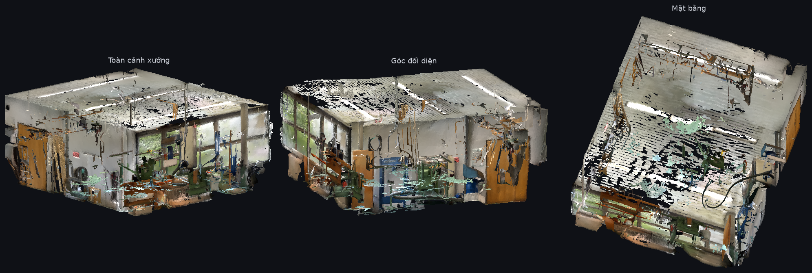
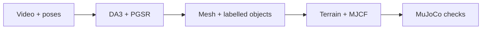
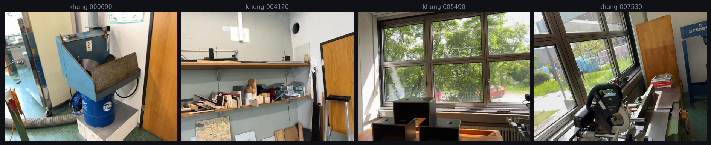
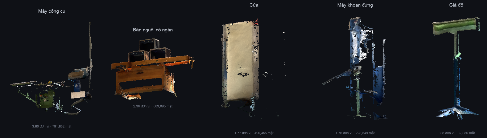

# Video-to-Terrain

**Monocular RGB video → 3D reconstruction → terrain and robot simulation.**

Reconstruct a scanned environment as a point cloud, mesh, labelled 3D objects,
terrain heightfield, and MuJoCo scene. The pipeline combines Depth Anything 3,
planar 3D Gaussian Splatting, semantic segmentation, and collision geometry export.

[](pyproject.toml) [](scripts/sim/) [](LICENSE)



*Reconstruction from the workshop scan: two exterior views and a view from above.*

[Demo videos](#demo-videos) · [Quickstart](#quickstart) · [Pipeline](#pipeline) · [Documentation](#documentation)

## Demo videos

These clips are included in the repository and can be opened directly on GitHub.

| Demo | What it shows |
| :--- | :--- |
| [Scene manipulation](output/REPORT/media/usecase_move_around.mp4) | Moving extracted objects in the reconstructed scene |
| [Robot heading test](output/REPORT/media/heading_270.mp4) | Recorded humanoid locomotion in MuJoCo |
| [Motion and stairs](output/REPORT/media/comparison_xingying_ct22_stairs.mp4) | Comparing a motion sequence with its supporting stair geometry |
| [Capture coverage gap](output/REPORT/media/rgbd_capture_gap.mp4) | Missing observations that motivate object completion |

For the local HTML report:

```bash
python3 -m http.server 8790 --directory output/REPORT
```

Open `http://127.0.0.1:8790`. The report pages, figures, and selected clips are
tracked; full 3D viewers also need the meshes and assets from the corresponding
local delivery bundle. See the [viewing guide](output/REPORT/HUONG_DAN_XEM.md).

## Quickstart

Use Python 3.11 for the pinned local environment. Package metadata allows Python
3.10–3.13; the default Makefile interpreter is `python3.11`.

```bash
git clone https://github.com/huytrao/Video-to-terrain.git
cd Video-to-terrain

make setup
make test
make help
```

`make setup` creates `.venv`, installs [requirements.txt](requirements.txt), and
installs the `v3d` package. It uses `uv` when available, otherwise `venv` and `pip`.
`make test` runs the geometry and pose regression suites.

For workflows that use remote services, copy the environment template and fill
in the credentials required for that workflow:

```bash
cp .env.example .env
```

Inspect the reconstruction CLI:

```bash
.venv/bin/python -m v3d.paper_runner --help
```

### Run a prepared scene

The reconstruction runner consumes images and camera poses. A flat scene has
`images/` and `transforms_undistorted.json` inside its scene directory. Replace
`YOUR_SCENE` and the paths below with your prepared data:

```bash
.venv/bin/python -m v3d.paper_runner YOUR_SCENE \
  --stage report \
  --data-root /path/to/posed-scenes \
  --work-root /path/to/run
```

`report` lists available artifacts. Heavy reconstruction runs in a prepared
NVIDIA GPU environment with model weights and upstream checkouts installed.
The recorded deployment uses an offline Kaggle kernel:

```bash
make kaggle-ping
make kaggle-deploy
```

Inside that prepared GPU environment, `v3d.paper_runner` supports `--stage all`
or individual stages: `da3`, `pgsr`, `mesh`, `vlm`, `sam3`, `postprocess`, `scene`,
and `gate`. The GPU setup, input preparation, and delivery steps are described in
the [Kaggle guide](docs/guides/kaggle-deployment.md) and
[recorded pipeline runbook](docs/guides/pipeline-runbook.md).

## Pipeline



- **Reconstruct geometry:** infer depth with DA3, optimize planar Gaussians with
  PGSR, and fuse surfaces into a mesh.
- **Recover objects:** combine VLM labels, SAM 3 masks, and Holi-Spatial lifting
  to produce labelled 3D boxes and object assets.
- **Build collision geometry:** derive a heightfield, separate object footprints
  from the ground, and use wall primitives to preserve door openings.
- **Inspect simulation:** compile the scene, check coordinates and contacts,
  and run robot playback when compatible robot and policy assets are available.



*Input frames from the workshop scan. The reconstruction stages share camera
poses so geometry, masks, and object boxes use the same scene coordinates.*

Prompt-driven terrain and mocap stair fitting are integrations with the companion
`Images_to_terrain` project. This checkout provides mesh-to-heightfield export
and the Hunyuan3D object-completion adapter. See the
[terrain integration guide](docs/guides/text-to-terrain-integration.md).

## Outputs

| Output | Format | Use |
| :--- | :--- | :--- |
| Dense point cloud | `.ply` | Geometry inspection and downstream processing |
| Reconstructed mesh | `.glb`, `.obj`, `.ply` | Scene visualization and geometry export |
| Semantic objects | `.json` and per-object meshes | Labelled boxes, poses, and object assets |
| Terrain | `.npy`, heightfield `.png` | Elevation, slope, step height, and traversability |
| Simulation scene | MJCF `.xml` and assets | MuJoCo collision and robot experiments |
| Run evidence | Reports, figures, `.mp4` | Reviewing reconstruction and simulation results |



*Object-level geometry exported from the same scan. Large meshes and generated
simulation bundles are kept outside Git; the figures above are tracked.*

## MuJoCo simulation

With a room mesh, its box metadata, and a robot asset directory available:

```bash
make room-scene \
  ROOM=/path/to/room.glb \
  ROOM_GT=/path/to/ground_truth_boxes.json \
  ROOM_OUT=outputs/room \
  ROOM_ROBOT=/path/to/unitree_robots/robot_model

make room-view ROOM_OUT=outputs/room
```

The robot directory must contain `origin/` and `meshes/`. `ROOM_OUT` is explicit
because the Makefile does not currently define a default. The room builder runs
its physics checks during assembly. Walking playback additionally requires a
compatible ONNX policy and deployment YAML.

See the [room-to-robot guide](docs/guides/room-to-robot-scene.md) and
[walking script](scripts/sim/walk_tour.py) for the scene and policy interfaces.
The separate factory heightfield validator expects `scene_factory.xml` and its
report/terrain files; it does not validate the room builder's `room_scene.xml`.

### Scale and physics

Reconstruction coordinates remain `da3_estimate` until a physical reference
calibrates scale with `--metres-per-unit`. Material and contact defaults carry
`assumed` provenance. Visual meshes and collision geometry are exported
separately so a concave room is not treated as one solid convex collider.

Geometry regression tests, scene contact checks, and real-world measurement
validate different things. Recorded metrics and their context are kept in the
[technical report](docs/reference/technical-report.md#industrial-benchmark-small-factory-scene).

## Repository layout

```text
src/v3d/        Reconstruction package and stage runner
scripts/        GPU, deployment, export, and simulation tools
tests/          Geometry and camera-pose regression suites
configs/        Checked-in configuration
docs/           Architecture, guides, references, and run notes
output/REPORT/  Report pages and selected demonstration media
```

## Documentation

| Start here | Contents |
| :--- | :--- |
| [Documentation index](docs/README.md) | All guides and references |
| [Technical report](docs/reference/technical-report.md) | Detailed architecture, equations, recorded benchmarks, and execution notes |
| [Architecture](docs/architecture/architecture-graph.md) | Data flow, coordinate frames, and export design |
| [GPU deployment](docs/guides/kaggle-deployment.md) | Offline Kaggle setup and proxy workflow |
| [Object completion](docs/guides/holispatial-hunyuan3d-adapter.md) | Holi-Spatial to Hunyuan3D adapter |
| [Script catalog](scripts/README.md) | Executables grouped by where they run |
| [Engineering rules](AGENTS.md) | Units, coordinate invariants, and development checks |

## License

[MIT](LICENSE). Upstream models, datasets, and vendored projects retain their own licenses.
