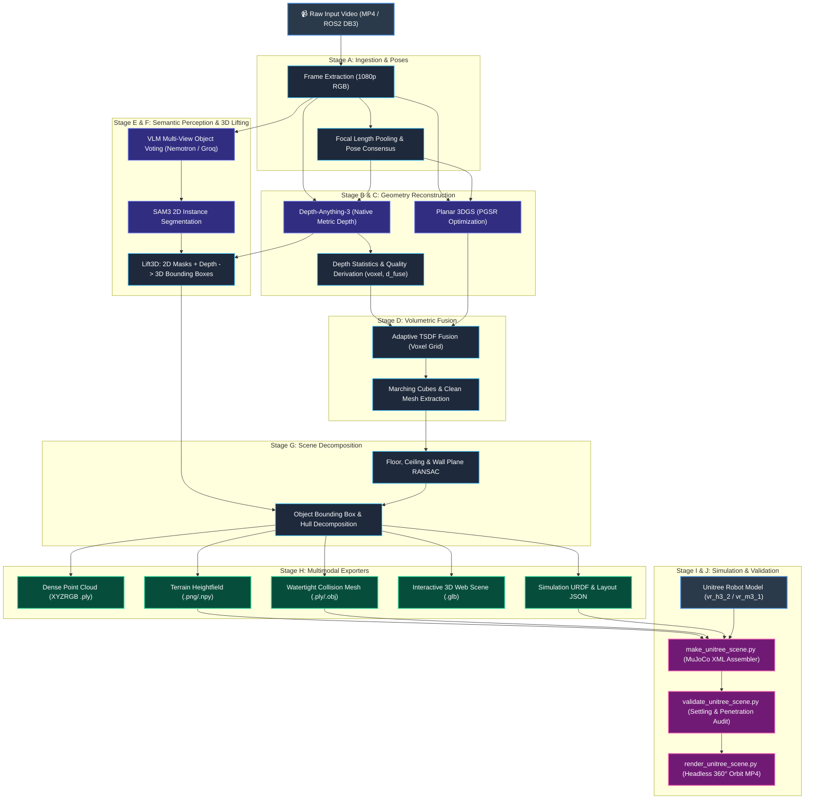
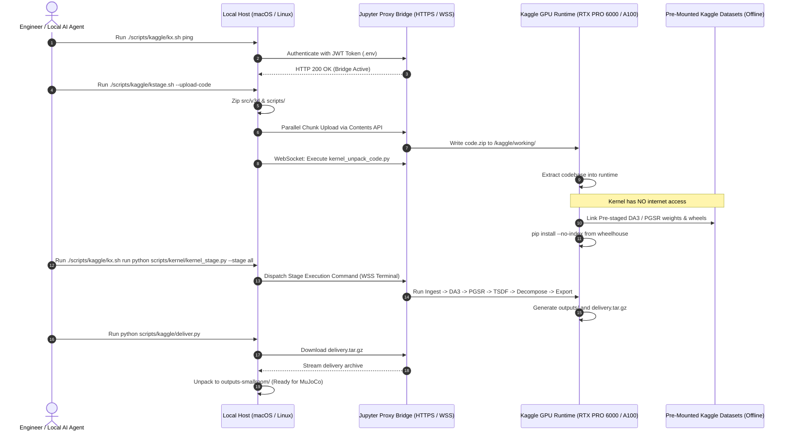
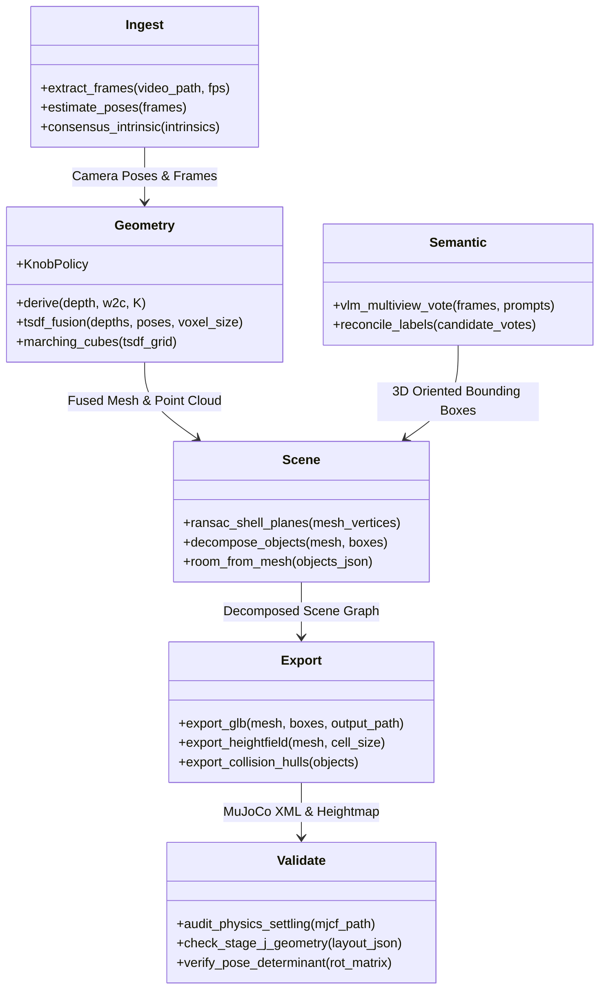

# 📊 Videos_to_3D Architecture & Dataflow Graphs

This document provides visual diagrams (Mermaid graphs) illustrating the architecture, mathematical coordinate bridges, dataflow pipelines, and infrastructure mechanics of the `Videos_to_3D` project.

---

## 1. 🔄 End-to-End Pipeline Dataflow (Stage A $\to$ Stage J)

---

## 2. ☁️ Remote Kaggle GPU Hybrid Bridge Infrastructure

---

## 3. 📐 Coordinate Frame Transformations & Mathematical Invariants

```mermaid
graph LR
    subgraph OpenCV ["📸 OpenCV Camera Frame"]
        direction TB
        CV_X["+X : Right"]
        CV_Y["+Y : Down"]
        CV_Z["+Z : Forward"]
        CV_Desc["Used in: Raw Video, Frames, COLMAP"]
    end

    subgraph OpenGL ["🌐 OpenGL / NeRF Frame"]
        direction TB
        GL_X["+X : Right"]
        GL_Y["+Y : Up"]
        GL_Z["-Z : Forward"]
        GL_Desc["Used in: DA3, 3DGS, PGSR, WebGL"]
    end

    subgraph MuJoCo ["🤖 MuJoCo / ROS World Frame"]
        direction TB
        MJ_X["+X : Forward"]
        MJ_Y["+Y : Left"]
        MJ_Z["+Z : Up"]
        MJ_Desc["Used in: Robot URDF, RL Policy, MJCF"]
    end

    OpenCV -- "c2w_gl = c2w_cv * diag(1, -1, -1, 1)" --> OpenGL
    OpenGL -- "Gravity RANSAC + Axis Mapping" --> MuJoCo
```

---

## 4. 🧩 Package & Module Architecture (`src/v3d/`)

