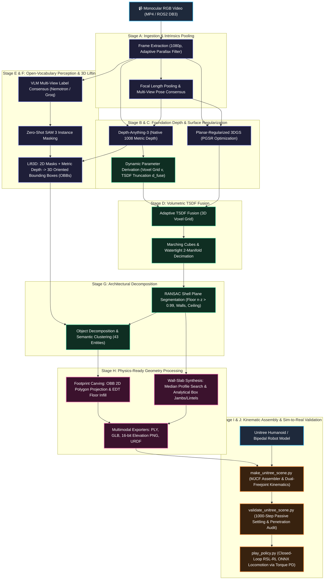
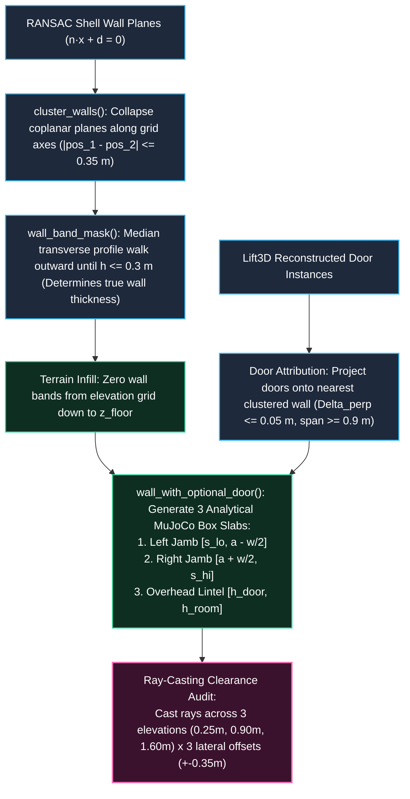
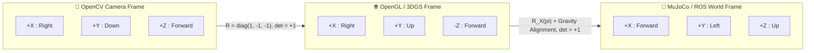
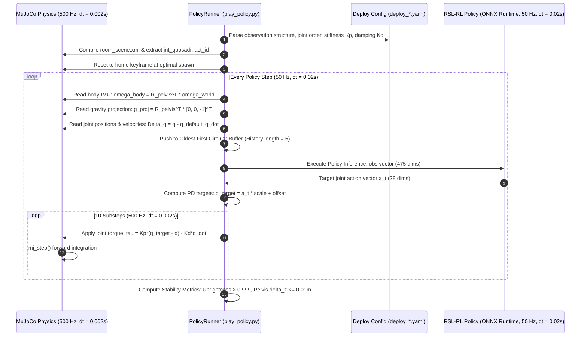
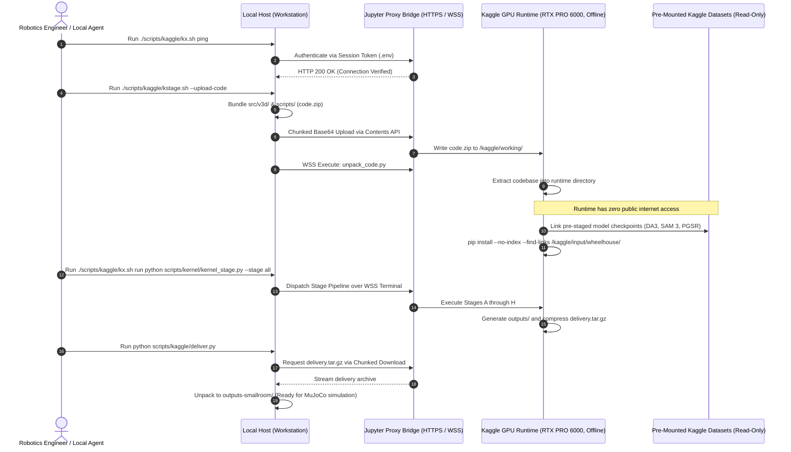
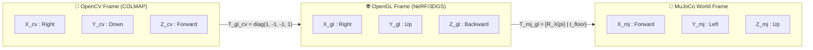
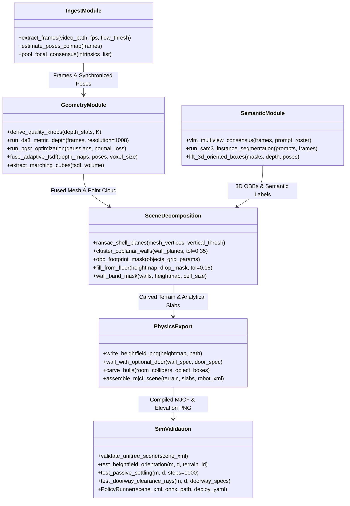

# 📊 Videos_to_3D Architecture & Technical Dataflow

This document details the software architecture, coordinate transformations, mathematical formulations, and sim-to-real mechanics implemented in `Videos_to_3D`. The pipeline transforms monocular RGB video into topologically structured, metric digital twins and numerically stable [MuJoCo](https://mujoco.org/) physics environments.

---

## 1. 🔄 End-to-End Pipeline Architecture (Stage A $\to$ Stage J)

The pipeline executes a ten-stage feedforward DAG designed to prevent early-stage estimation drift from propagating into physical contact mechanics.



### Stage Pipeline Execution Parameters
1. **Stage A (Ingest)**: Temporal frame subsampling at dynamic stride based on inter-frame optical flow ($\Delta \theta > 2.5^\circ$ or baseline displacement $\Delta t > 0.08\,\text{m}$). Focal pooling filters focal shifts across zooming frames, locking intrinsic matrix $K$.
2. **Stages B & C (Geometry)**: Depth-Anything-3 evaluates views at native $1008 \times 1008$ resolution, bounding scale variance to $0.11\%$. Planar 3DGS optimizes flat surface priors through geometric normal consistency $\mathcal{L}_{\text{normal}} = \| \mathbf{n}_{\text{render}} - \mathbf{n}_{\text{pseudo}} \|_1$.
3. **Stage D (Volumetric TSDF)**: Voxel size dynamically scales according to scene depth:
   $$v = \operatorname{clamp}\left(1.75 \cdot \frac{d_{\text{med}}}{f}, \frac{D_{\text{scene}}}{6000}, \frac{D_{\text{scene}}}{2500}\right)$$
   Marching Cubes extracts a watertight surface, decimated from 39.8M raw faces to 1.5M simulation-tractable faces.
4. **Stages E & F (Perception & 3D Lifting)**: Multi-view VLM scoring builds consensus on semantic classes. SAM 3 produces pixel-accurate masks, back-projected with DA3 depth into oriented 3D bounding boxes $\mathcal{B}_k = (\mathbf{c}_k, \mathbf{e}_k, R_k)$.
5. **Stage G (Decomposition)**: Orthogonal RANSAC planes isolate dominant architectural surfaces ($\mathbf{n} \cdot \hat{\mathbf{z}} > 0.99$ for floor) and assign unsegmented vertices to discrete obstacle clusters.
6. **Stages H, I & J (Physics Synthesis & Validation)**: Terrain footprint carving, analytical wall-slab replacement, MJCF compilation, and closed-loop humanoid settling/locomotion testing.

---

## 2. 💥 Engineering Differentiator 1: Resolving the MuJoCo Collision Explosion

### 2.1 The Failure Mode: Continuous Mesh Embedding
Standard photogrammetric and TSDF meshes reconstruct continuous 2-manifold surfaces. In an industrial facility, heavy equipment (lathes, workbenches, presses) are physically connected to the floor in the reconstructed mesh.

When robotics developers attempt to populate such a scene for rigid-body simulation by superimposing detected 3D bounding boxes or convex hull colliders over the raw mesh:
1. **Severe Geometric Penetration**: The continuous terrain already contains $97\%$ of the interior volume of the equipment. Adding separate rigid colliders creates **63 intersecting collision pairs** at $t=0$, with initial penetrations up to $0.57\,\text{m}$.
2. **Solver Divergence**: MuJoCo's contact solver (`implicitfast` / Projected Gauss-Seidel) attempts to enforce non-penetration constraints simultaneously against conflicting contact normals. Normal forces spike beyond $10^5\,\text{N}$, generating extreme generalized velocities ($|q_{\text{vel}}| \sim 48.8\,\text{rad/s}$) within 3 simulation steps. The simulation either aborts with `qvel became non-finite` or violently ejects the robot across the room.

```
Naive Superposition (Collision Explosion):
Raw TSDF Mesh:       ═══════════╦══════════════╦═══════════   (Terrain embodies machine)
Object Bounding Box:            │ ▓▓▓▓▓▓▓▓▓▓▓▓ │               (Overlap: deep penetration)
                                └──────────────┘
MuJoCo Solver:       Penetration = 0.57 m -> Force > 10^5 N -> |qvel| = 48.8 -> DIVERGENCE!
```

### 2.2 Algorithmic Solution: RANSAC Separation + Footprint Carving

```mermaid
flowchart LR
    classDef step fill:#1e293b,stroke:#38bdf8,stroke-width:1.5px,color:#fff;
    classDef state fill:#064e3b,stroke:#34d399,stroke-width:2px,color:#fff;

    TSDFMesh["Raw TSDF Mesh & 3D OBBs"]:::step --> RANSACFloor["1. RANSAC Floor Plane Extraction\n(n_floor·z > 0.99, z_floor = p10(h))"]:::step
    RANSACFloor --> OBBProj["2. 2D OBB Polygon Projection\n(Project 8 corners to uv-plane, ConvHull)"]:::step
    OBBProj --> FootprintMask["3. Footprint Rasterization\n(Half-space inequality test: P·n_h + d_h <= 0)"]:::step
    FootprintMask --> EDTFill["4. Euclidean Distance Transform Infill\n(Interpolate floor from flat cells h < z_floor + 0.15m)"]:::step
    EDTFill --> ColliderSlice["5. Room Collider Half-Plane Slicing\n(carve_hulls: slice colliders clear of OBBs)"]:::step
    ColliderSlice --> StableScene["Physics-Stable Scene\n(0 overlapping pairs, |qvel| <= 8.87 rad/s)"]:::state
```



#### Detailed Algorithmic Mechanics:
1. **RANSAC Floor Separation**: Isolates the ground plane and establishes reference elevation $z_{\text{floor}} = \operatorname{percentile}_{10}(h_{\text{keep}})$, rejecting floating outlier points below the actual floor.
2. **OBB Footprint Projection (`obb_footprint_mask`)**:
   For each object with center $\mathbf{c} \in \mathbb{R}^3$, extent $\mathbf{e} \in \mathbb{R}^3$, and orientation matrix $A \in \mathrm{SO}(3)$:
   $$\mathbf{p}_k = \mathbf{c} + \left( \mathbf{s}_k \odot \mathbf{e} \right) A, \quad \mathbf{s}_k \in \{-0.5, +0.5\}^3, \quad k \in \{1, \dots, 8\}$$
   Each corner is projected onto the 2D grid plane $(u, v)$:
   $$u_k = \mathbf{p}_k \cdot \mathbf{a}_x - u_0, \quad v_k = \mathbf{p}_k \cdot \mathbf{a}_y - v_0$$
   The convex hull of the 8 projected vertices forms an oriented 2D polygon. Testing grid coordinates against the polygon's half-space equations marks occupied terrain cells $\mathcal{M}_{\text{obj}}$.
   *(Rasterizing axis-aligned bounding boxes (AABB) would over-claim footprint by $75\%$ for rotated machinery, falsely classifying $79\%$ of the floor as occupied instead of the true $45.5\%$).*
3. **Floor-Level Infill via Distance Transform (`fill_from_floor`)**:
   Masked cells cannot simply be set to nearest-neighbour heights (which would propagate adjacent machine ledge heights). Instead, `scipy.ndimage.distance_transform_edt` samples only from locally verified floor cells ($h < z_{\text{floor}} + 0.15\,\text{m}$), producing a flat ground surface underneath the equipment.
4. **Collider Half-Plane Slicing (`carve_hulls`)**:
   For manipulation scenes where equipment must move (`--objects-as-bodies`), room convex hull colliders that intersect an object's OBB are clipped along the object's boundary half-planes. Fully submerged colliders are discarded, and intersecting colliders are shrunken clear of the object volume.

```
Carved & Decoupled Representation (Numerically Stable):
Carved Terrain:      ════════════────────────────────────═══   (Terrain carved flat to floor)
Dynamic Body / Box:             ┌──────────────┐               (Independent rigid body)
                                │ ▓▓▓▓▓▓▓▓▓▓▓▓ │               
                                └──────────────┘               (Air gap / contact clearance: 0 penetration)
MuJoCo Solver:       Initial contacts = 0 -> Settling contact forces normal -> STABLE!
```

---

## 3. 🚪 Engineering Differentiator 2: 2.5D Heightfield Opening Bottleneck & Wall-Slab Insertion

### 3.1 The Mathematical Limitation of 2.5D Heightfields
For legged locomotion and terrain traversability, 2.5D digital elevation models ($z = f(x, y)$) are standard due to compact storage ($512 \times 510$ 16-bit PNG) and fast ray/contact evaluation.

However, a heightfield is strictly a **single-valued function**. It cannot represent:
- Vertical undercuts and horizontal tunnels.
- Doorways and pass-through openings with a lintel or ceiling overhead.

When raw wall geometry is rasterized into a heightfield:
- Walls become solid vertical dams across the elevation grid.
- Doorway openings are filled with solid terrain up to wall height.
- Any simulated robot attempting to navigate through a doorway is physically blocked by an artificial terrain ridge.

```
2.5D Heightfield Topological Limitation:
Reconstructed Mesh:     ┌────────┐  Door Opening  ┌────────┐
                        │ Wall   │  [ PASSABLE ]  │ Wall   │
                        │        │                │        │
2.5D Elevation Grid:    ████████████████████████████████████   <- IMPASSABLE! Heightfield cannot have holes!
```

### 3.2 Algorithmic Solution: Explicit Wall-Slab Architecture



#### Detailed Algorithmic Mechanics:
1. **Wall Plane Clustering (`cluster_walls`)**:
   RANSAC plane fitting often produces redundant planes on large walls (e.g. 7 planes for 4 walls). Planes are collapsed along grid axes $u, v$ by comparing normal distances $-d / n_u$ or $-d / n_v$ within tolerance $\delta = 0.35\,\text{m}$.
2. **Median Transverse Profile Walking (`wall_band_mask`)**:
   A constant-width mask either leaves residual wall ridges or carves into interior machinery. The algorithm computes the median transverse profile:
   $$\operatorname{prof}(c) = \operatorname{median}_{k} H(k, c) \quad (\text{or } \operatorname{median}_{k} H(c, k))$$
   It marches outward from the wall centerline until elevation drops below floor threshold ($0.30\,\text{m}$), dynamically determining true wall span and preventing adjacent machines from skewing wall boundaries.
3. **Wall Band Terrain Removal**:
   The entire wall footprint is cleared from the heightfield and filled to floor level via EDT, guaranteeing that the terrain beneath the doorway is completely flat.
4. **Analytical Slab Synthesis (`wall_with_optional_door`)**:
   Reconstructed walls containing doorways are replaced with three analytical `<geom type="box">` primitives in the MJCF model:
   - **Segment 0 (Left Jamb)**: Along-axis span $[s_{\text{lo}}, a_{\text{door}} - w/2]$, full room height $h_{\text{room}}$.
   - **Segment 1 (Right Jamb)**: Along-axis span $[a_{\text{door}} + w/2, s_{\text{hi}}]$, full room height $h_{\text{room}}$.
   - **Lintel Slab**: Centered at door position $a_{\text{door}}$, span $[-w/2, +w/2]$, vertical elevation $z \in [h_{\text{door}}, h_{\text{room}}]$.
5. **Multi-Horizon Ray-Casting Clearance Audit (`validate_unitree_scene.py`)**:
   Passability is mathematically verified before simulation by casting horizontal rays across 3 heights ($z \in \{0.25, 0.90, 1.60\}\,\text{m}$) and 3 lateral offsets ($\Delta \in \{-0.35, 0.0, +0.35\}\,\text{m}$), ensuring unobstructed passage over a depth of $1.8\,\text{m}$.

```
Wall-Slab Insertion Result in MuJoCo:
Heightfield:    ═══════════════════════════════════════════════════   (Flat floor throughout)
Wall Geoms:     ┌────────┐       ┌──────────────┐      ┌────────┐
                │ Jamb 0 │       │ Lintel Slab  │      │ Jamb 1 │
                │        │       └──────────────┘      │        │
                │        │        ROBOT PASSABLE       │        │
                └────────┘                             └────────┘
```

---

## 4. 🤖 Engineering Differentiator 3: Sim-to-Real Kinematic Mapping & Closed-Loop Locomotion Playback

### 4.1 Coordinate Chirality & Handedness ($\det(R) = +1$)
Computer vision frameworks (OpenCV, COLMAP) use $+X$ right, $+Y$ down, $+Z$ forward. Robotics and physics engines (MuJoCo, ROS) operate with $+X$ forward, $+Y$ left, $+Z$ up.

A common pitfall is flipping only the $Z$ coordinate ($z \to -z$). This represents a **reflection matrix** ($\det(R) = -1$), which mirrors coordinate chirality:
- A right-handed robot model becomes left-handed.
- Contact friction cones and gyroscopic Coriolis matrices invert sign.

The pipeline enforces proper chirality via a $180^\circ$ rotation about the $X$ axis:
$$R_X(\pi) = \begin{bmatrix} 1 & 0 & 0 \\ 0 & -1 & 0 \\ 0 & 0 & -1 \end{bmatrix}, \quad \det(R_X(\pi)) = +1$$
This is followed by ground normalization shifting $z_{\text{floor}} \to 0$.



### 4.2 Multi-Freejoint Kinematic Address Resolution
Robotics scenes often incorporate free-floating control probes, camera anchors, or free obstacles alongside the robot.
- In MuJoCo, each `free` joint adds 7 generalized coordinates ($[x, y, z, q_w, q_x, q_y, q_z]$) to `qpos`.
- Hardcoding `qpos[0:7]` to set the robot's pelvis binds the initial pose to the *first* declared body (e.g. a control probe), while the robot's pelvis receives truncated joint coordinates.
- **Empirical Failure**: The robot spawns with `pelvis z = 0.0` (inside the ground) without triggering XML parsing errors.

**The Fix**: Dynamic indexing via MuJoCo model descriptors:
```python
free_joints = [j for j in range(model.njnt)
               if model.jnt_type[j] == mujoco.mjtJoint.mjJNT_FREE
               and model.jnt_bodyid[j] == pelvis_id]
root_qpos = model.jnt_qposadr[free_joints[0]]
root_qvel = model.jnt_dofadr[free_joints[0]]
```

### 4.3 EDT Optimal Spawn Search
Spawning a robot at the naive geometric center of a reconstructed industrial hall placed the generic humanoid robot inside `obs_55_machine`, generating 88 initial collision points and $0.57\,\text{m}$ penetration.

The pipeline searches a $120 \times 120$ ground clearance grid using Euclidean Distance Transform:
$$\mathbf{x}^*_{\text{spawn}} = \arg\max_{\mathbf{x} \in \mathcal{F}_{\text{interior}}} \left( \operatorname{EDT}(\neg \mathcal{M}_{\text{obstacle}})(\mathbf{x}) \right) \quad \text{s.t.} \quad \Delta h_{\text{local}} < 0.06\,\text{m}$$
This identified an optimal spawn with $1.007\,\text{m}$ radius clearance, reducing initial contacts from 88 to **2** (the robot's foot soles).

### 4.4 Closed-Loop RSL-RL Locomotion Policy Playback



#### Observation State Representation (475 Dimensions):
The observation buffer is constructed dynamically from `deploy_*.yaml` using an oldest-first circular buffer:
- **Base Angular Velocity** ($3 \times 5 = 15$ dims): Body-frame IMU angular rate $\boldsymbol{\omega}_{\text{body}} = R_{\text{pelvis}}^T \boldsymbol{\omega}_{\text{world}}$.
- **Projected Gravity** ($3 \times 5 = 15$ dims): $\mathbf{g}_{\text{proj}} = R_{\text{pelvis}}^T [0, 0, -1]^T$.
- **Velocity Commands** ($3 \times 5 = 15$ dims): Commanded $[v_x, v_y, \omega_z]$.
- **Joint Position Offsets** ($28 \times 5 = 140$ dims): $\mathbf{q} - \mathbf{q}_{\text{default}}$.
- **Joint Velocities** ($28 \times 5 = 140$ dims): Generalized joint velocity $\dot{\mathbf{q}}$.
- **Previous Actions** ($28 \times 5 = 140$ dims): Previous action vector $\mathbf{a}_{t-1}$.
- **Gait Phase** ($2 \times 5 = 10$ dims): $[\sin(2\pi t / T), \cos(2\pi t / T)]$ (zeroed during standing command).

#### Explicit Multi-Rate Torque PD Law:
MuJoCo actuators in the imported robot are unpowered torque motors (`gainprm=1`, `biasprm=0`). The PD control loop executes at $500\,\text{Hz}$ across 10 substeps for each $50\,\text{Hz}$ policy decision:
$$\boldsymbol{\tau} = \mathbf{K}_p \left( \mathbf{a}_t \odot \mathbf{s}_{\text{action}} + \mathbf{o}_{\text{offset}} - \mathbf{q} \right) - \mathbf{K}_d \dot{\mathbf{q}}$$

#### Empirical Validation Benchmark (Unitree Humanoid Robot, 10s Stand Test):
| Metric | Value | Threshold / Target | Status |
| :--- | :--- | :--- | :--- |
| **Initial Pelvis Height** | $0.8410\,\text{m}$ | $0.8410\,\text{m}$ (Nominal) | PASS |
| **Settled Pelvis Height** | $0.8317\,\text{m}$ | $\Delta z \le 0.02\,\text{m}$ | PASS |
| **Torso Uprightness** | $0.9995$ | $> 0.9950$ | PASS |
| **Final Drift (Last 1.0 s)** | $0.0001\,\text{m}$ | $< 0.0050\,\text{m}$ | PASS |
| **Initial Overlap Penetration** | $0\,\text{mm}$ | $< 5.0\,\text{mm}$ | PASS |
| **Solver Velocity Spike $|q_{\text{vel}}|$** | $8.87\,\text{rad/s}$ | $< 15.0\,\text{rad/s}$ | PASS |

---

## 5. ☁️ Remote Kaggle GPU Hybrid Bridge Infrastructure

The reconstruction stages execute on an offline Kaggle Blackwell GPU (RTX PRO 6000, 96 GiB VRAM), orchestrated locally via a bidirectional Jupyter Contents API bridge.



---

## 6. 📐 Coordinate Frame Transformations & Mathematical Invariants



### Mathematical Transformation Contracts:
1. **OpenCV to OpenGL**:
   $$T_{\text{gl}\leftarrow\text{cv}} = \begin{bmatrix} 1 & 0 & 0 & 0 \\ 0 & -1 & 0 & 0 \\ 0 & 0 & -1 & 0 \\ 0 & 0 & 0 & 1 \end{bmatrix}, \quad \det(T_{1:3, 1:3}) = +1$$
2. **OpenGL to MuJoCo Simulation**:
   $$T_{\text{mj}\leftarrow\text{gl}} = \begin{bmatrix} R_X(\pi) & \mathbf{t}_{\text{floor}} \\ \mathbf{0}^T & 1 \end{bmatrix} = \begin{bmatrix} 1 & 0 & 0 & -x_0 \\ 0 & -1 & 0 & y_0 \\ 0 & 0 & -1 & z_{\text{floor}} \\ 0 & 0 & 0 & 1 \end{bmatrix}, \quad \det(T_{1:3, 1:3}) = +1$$
3. **Chirality Invariant Assertion**:
   $$\forall T \in \mathcal{T}_{\text{pipeline}}, \quad \det(R(T)) = +1 \pm 10^{-6}$$
   Any transformation producing $\det(R) = -1$ violates orientation invariants and halts execution.

---

## 7. 🧩 Package Architecture (`src/v3d/` & `scripts/sim/`)


