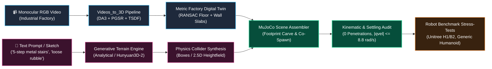
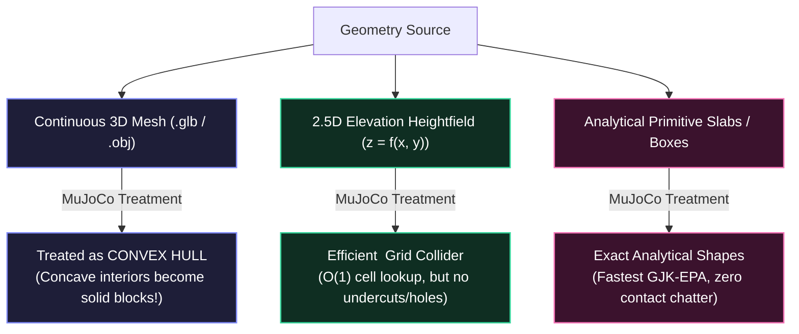
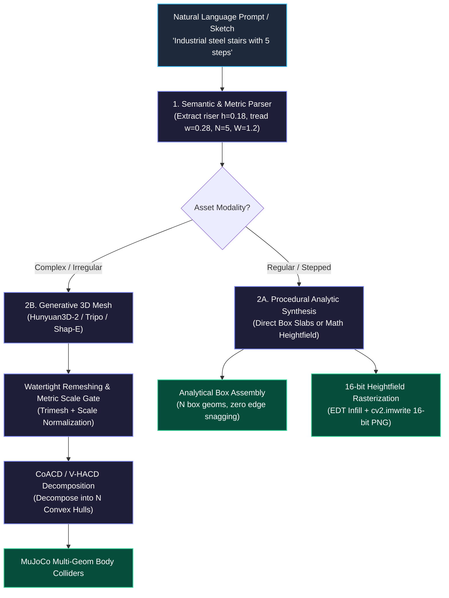
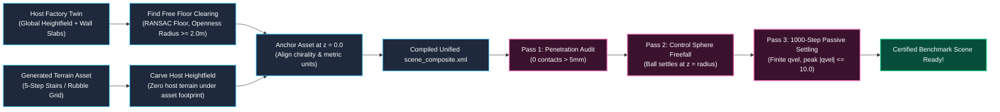

# 🏔️ Text-to-Terrain Integration Guide: Generative Synthesis & Real-to-Sim Physics Benchmarking

> **Audience:** Robotics researchers, simulation engineers, and perception leads building metric digital twins for legged locomotion and manipulation.  
> **Repository Context:** [`Videos_to_3D`](.) end-to-end framework.  
> **Core Objective:** Bridge passive monocular Video-to-3D reconstructions with active Generative Text-to-Terrain synthesis to unlock adversarial stress-testing in [MuJoCo](https://mujoco.org/).

---

## 0. Executive Summary: The Gap Between Scanning and Testing

A perfect monocular 3D scan of an industrial plant (such as pilot scene `00777c41d4`) gives robotics engineers an authentic, metric reproduction of a real space: floor planes, machine envelopes, door clearances, and ambient textures. However, as an engineering testbed for autonomous mobile manipulation and legged locomotion, **a static scan alone is dangerously insufficient**:

1. **The Nominal Trap:** Real factories are scanned during normal operation. Floors are swept, ramps are standard, and obstacles are stationary. Training or certifying a robot policy exclusively inside this scanned volume produces a policy that overfits to benign conditions.
2. **Safety and Cost Prohibitions:** You cannot rebuild a customer's physical factory floor to include crumbling concrete steps, oil-slick inclines, or a collapsed 5-step industrial gantry merely to measure the rollover margin of a $100,000 humanoid robot.
3. **The Solution — Real-to-Sim + Generative Terrain Synthesis:** We retain the scanned factory digital twin as the metric ground-truth host environment (Real-to-Sim), and synthetically inject generative text-to-terrain assets—such as parameterized stairs, obstacle courses, and rubble fields—into the room's traversable free space.



---

## 1. Architectural Motivation: Why Video-to-3D Reconstruction Needs Generative Terrain

### 1.1 The Real-to-Sim & Sim-to-Real Asymmetry
The fundamental goal of Real-to-Sim in robotics is **verifiability**. If a robot cannot balance or navigate inside a high-fidelity digital twin of the target site, it will fail on hardware. 

However, monocular Video-to-3D reconstruction (as executed across Stages A through J in [`docs/architecture/architecture-graph.md`](docs/architecture/architecture-graph.md)) is inherently passive:
- **Observation Bounds:** The reconstructed geometry is limited strictly to the camera operator’s field of view and trajectory. Unobserved zones (e.g. shadowed undercarriages of machinery or elevated catwalks) become hollow holes or interpolation artifacts.
- **Physical Monotony:** Real facilities are designed to be smooth and navigable for humans. Testing edge-case stability (such as maximum step climb limit, dynamic foot slip on grating, or pitch roll recovery on steep slopes) requires terrain extremes that simply do not exist in the source video.

| Dimension | Monocular Video Reconstruction (`Videos_to_3D`) | Generative Text-to-Terrain Synthesis | Hybrid Co-Simulation (This Architecture) |
| :--- | :--- | :--- | :--- |
| **Geometry Origin** | Photometric video observations | Text prompts, parameter ranges, sketches | Real factory context + synthetic hazards |
| **Dimensional Truth** | Grounded in scene metric depth (DA3) | Parametric or generative normalized | Aligned to factory world coordinates |
| **Variability** | Deterministic (1 scene = 1 mesh) | Infinite (domain randomization / curriculum) | Infinite permutations inside authentic room |
| **Role in Sim-to-Real** | Anchors ambient scale, layout, walls | Pushes policy to physical failure boundaries | Evaluates navigation in real layout with hard obstacles |

### 1.2 The Closed Real-to-Sim-to-Real Loop
By uniting both methodologies, the verification loop functions systematically:
1. **Real $\to$ Sim (Baseline Capture):** The mobile scanner walks the plant. [`Videos_to_3D`](.) recovers the global floor plane ($z_{\text{floor}} = 0$), wall envelopes, doorways, and machine oriented bounding boxes (OBBs).
2. **Generative Insertion (Adversarial Curriculum):** An operator or automated RL curriculum generator prompts text-to-terrain assets into identified open clearings:
   - *"Industrial steel stairs with 5 steps, 18 cm rise, 28 cm run, grating texture."*
   - *"Debris field with 12 cm scattered concrete chunks across a 3x2 m passage."*
   - *"Wet metal access ramp inclined at 18 degrees leading to machine obj_0014."*
3. **Sim $\to$ Real (Policy Transfer):** Locomotion policies (e.g. trained via RSL-RL or Isaac Gym) are validated against these composite scenes. If the humanoid's foot strikes the stair nosing or slips on the simulated incline, the policy's gait, swing height, or impedance gains are updated before deployment.

---

## 2. Fundamental Spatial Data Representations

Converting visual geometry into rigid-body physics requires selecting the correct data representation. Confusing visual meshes with physics colliders is the leading cause of simulator explosion.



### 2.1 Continuous 3D Mesh (`.glb` / `.obj` / `.ply`)
- **Mathematical Form:** Arbitrary 2-manifold surface composed of vertices $V \in \mathbb{R}^{N \times 3}$ and triangular faces $F \in \mathbb{N}^{M \times 3}$.
- **Strengths:** 
  - Complete 3D expressiveness: can represent overhangs, hollow undercuts, stair stringers, hollow pipes, and ceiling catwalks.
  - Carries high-resolution UV textures and normal maps for camera rendering.
- **The MuJoCo Simulation Traps:**
  1. *The Convex Hull Assumption:* MuJoCo's collision engine treats all mesh geometries (`<geom type="mesh">`) as **their convex hulls** unless explicitly decomposed. If you load an entire room mesh or a concave staircase as a single mesh collider, the robot is immediately ejected because the interior volume is simulated as a solid rock!
  2. *Triangle Mesh Contact Chatter:* Colliding a robot's rubber foot against a raw, non-watertight triangular mesh with 50,000 sliver polygons causes high-frequency normal direction switching. Solver contact forces spike, creating artificial energy drift and numerical instability.
  3. *The Rule of Decoupling:* Visual meshes should **never** be used directly as colliders. Always mark visual meshes with `contype="0" conaffinity="0" group="2"` and represent physical contact with primitives or heightfields.

### 2.2 2.5D Elevation Heightfield ($z = f(x, y)$)
- **Mathematical Form:** A single-valued elevation function discretized on a regular Cartesian grid:
  $$z_{i, j} = f(u_0 + i \cdot \Delta u, \; v_0 + j \cdot \Delta v), \quad i \in [0, N_u - 1], \; j \in [0, N_v - 1]$$
  Serialized as a 16-bit unsigned grayscale image (`.png`) where pixel intensity $[0, 65535]$ maps linearly to $[z_{\min}, z_{\max}]$.
- **Strengths:**
  - **$O(1)$ Contact Lookups:** Finding contact penetrations requires simple indexing into $(i, j)$ rather than traversing complex Bounding Volume Hierarchies (BVH).
  - **RL Policy Compatibility:** Standard RL locomotion policies (such as Walk-These-Ways, RSL-RL humanoid policies) take a $16 \times 16$ or $24 \times 24$ heightfield scan around the robot pelvis as exteroceptive observation.
- **Topological Bottlenecks:**
  - *Single-Valued Limitation:* Cannot represent true vertical walls without discretization slopes, and **cannot represent holes, doorways, tunnels, or stair undercuts**.
  - As established in [`docs/guides/room-to-robot-scene.md`](docs/guides/room-to-robot-scene.md), rasterizing a room wall into a heightfield turns doorways into impassable solid earth dams.

### 2.3 MuJoCo MJCF Physics Inclusion: `<hfield>` Element & Parameters
MuJoCo natively supports elevation grids via the `<hfield>` asset and `<geom type="hfield">`.

#### Asset Declaration Syntax
```xml
<asset>
  <!-- size: half-width-x  half-width-y  elevation-span  base-depth -->
  <hfield name="terrain_asset" file="terrain_elevation_16bit.png"
          size="5.120000 3.840000 0.850000 0.050000"/>
</asset>
```
The four components of the `size` attribute are critical:
1. `size[0]` ($s_x = \frac{\text{span}_x}{2}$): Half-extent along the local $X$ axis in meters.
2. `size[1]` ($s_y = \frac{\text{span}_y}{2}$): Half-extent along the local $Y$ axis in meters.
3. `size[2]` ($s_z = z_{\max} - z_{\min}$): Elevation scaling factor. A pixel value of $65535$ sits at $z = s_z$; a pixel value of $0$ sits at $z = 0$.
4. `size[3]` ($s_{\text{base}}$): Base foundation depth extending *below* $z = 0$. This prevents fast-moving robot feet from tunneling beneath the bottom of the heightfield during high-speed impacts.

#### Physics Geom Specification & Friction Tuning
```xml
<worldbody>
  <geom name="terrain_collider" type="hfield" hfield="terrain_asset"
        pos="5.120000 3.840000 -0.050000"
        friction="0.9 0.005 0.0001"
        solref="0.01 1.0"
        solimp="0.9 0.95 0.001 0.5 2"
        condim="3"
        material="terrain_mat"/>
</worldbody>
```

#### Detailed Contact Parameter Breakdown:
- **`friction="0.9 0.005 0.0001"`:**
  - *Tangential Friction ($\mu_t = 0.9$):* Standard Coulomb dry friction coefficient. For industrial metal grating, drop to $0.5$–$0.7$; for oily shop floors, drop to $0.2$.
  - *Torsional Friction ($\mu_{\text{torsion}} = 0.005$):* Resistance against spinning on a point contact.
  - *Rolling Friction ($\mu_{\text{roll}} = 0.0001$):* Prevents spherical feet or debris from rolling forever without damping.
- **`condim="3"` vs `"6"`:**
  - `condim="3"` simulates a standard 3D friction cone (normal force + 2 tangential axes).
  - `condim="6"` enables full 6D frictional contact (torsional friction + 2 rolling friction axes). Use `condim="6"` when stress-testing humanoid flat-foot pivoting on narrow stair treads.
- **`solref="0.01 1.0"` (Solver Reference Dynamics):**
  - First term ($\text{timeconst} = 0.01\,\text{s}$): The time constant of the soft contact constraint spring. Setting this too low ($< 0.001\,\text{s}$) causes solver stiffness and jitter; setting it too high causes the robot to sink into the floor like quicksand.
  - Second term ($\text{dampratio} = 1.0$): Damping ratio. $1.0$ is critical damping (zero restitution bounce).
- **`solimp="0.9 0.95 0.001 0.5 2"` (Solver Impedance):**
  - Controls constraint regularization across penetration depths. Ensures that light contact has gentle constraint forces, but deep penetration ($> 1\,\text{mm}$) ramps up stiffness sharply to prevent sinkage.

---

## 3. The Pipeline: From Text / Sketch to Physical Colliders

Generating terrain from text prompts or sketches requires a dedicated pipeline that enforces metric physical invariants rather than just producing uncalibrated computer graphics.



### 3.1 Step 1: Semantic Parsing and Metric Parameter Extraction
A text prompt like *"industrial metal stairs with 5 steps"* lacks explicit simulation dimensions. The parser translates natural language into a strict metric terrain specification:

```python
# dataclass specification for generated obstacles
@dataclass
class StairParameters:
    step_count: int = 5
    riser_height: float = 0.18      # meters (OSHA / DIN standard: 0.17 - 0.19 m)
    tread_depth: float = 0.28       # meters (standard run: 0.26 - 0.30 m)
    width: float = 1.20             # meters (clear stair width)
    stringer_thickness: float = 0.05
    friction_coefficient: float = 0.65  # metal grating
    solref: tuple[float, float] = (0.008, 1.0)
```

For sketches (e.g. hand-drawn obstacle height profiles):
1. Extract 1D contour profile $h(x)$ from binary image coordinates.
2. Filter high-frequency drawing jitter using a 1D Savitzky-Golay filter.
3. Extrude profile along transverse coordinate $y$ across specified width $W$.

### 3.2 Step 2: Generation Modalities — Procedural vs. Generative 3D

#### Modality A: Analytical Box Assembly (Recommended for Stairs & Platforms)
Attempting to represent stairs using a triangular mesh or a continuous heightfield is an engineering error:
- A heightfield creates vertical ramp slopes connecting steps due to cell interpolation, causing robot toes to slide.
- Triangular meshes have triangle boundaries across step nosings where contact solvers get stuck.
- **The Correct Solution:** Synthesize $N$ explicit `<geom type="box">` colliders:

```python
def generate_stair_mjcf_body(name: str, params: StairParameters, origin: np.ndarray) -> str:
    """Generate exact analytical MuJoCo box geoms for a staircase."""
    geoms = []
    x0, y0, z0 = origin
    w2 = params.width / 2.0
    
    for i in range(params.step_count):
        # Tread center calculation
        step_x = x0 + (i + 0.5) * params.tread_depth
        step_z = z0 + (i + 1.0) * params.riser_height - (params.riser_height / 2.0)
        
        # We model each step as a solid box down to the ground to prevent under-step trapping
        half_x = params.tread_depth / 2.0
        half_y = w2
        half_z = ((i + 1.0) * params.riser_height) / 2.0
        
        cz = z0 + half_z
        geoms.append(
            f'    <geom name="{name}_step_{i}" type="box" '
            f'pos="{step_x:.4f} {y0:.4f} {cz:.4f}" '
            f'size="{half_x:.4f} {half_y:.4f} {half_z:.4f}" '
            f'friction="{params.friction_coefficient} 0.005 0.0001" '
            f'solref="{params.solref[0]} {params.solref[1]}" '
            f'material="metal_stair_mat"/>'
        )
    return f'<body name="{name}">\n' + "\n".join(geoms) + "\n  </body>"
```

#### Modality B: Procedural 2.5D Heightfield Generation (For Uneven / Rubble Terrain)
For complex natural or obstacle terrains (e.g. *"steep rocky terrain with 20 degree incline and 8cm bumps"*):
1. Initialize elevation grid $Z \in \mathbb{R}^{N_v \times N_u}$ at metric resolution (e.g. $2\,\text{cm/cell}$).
2. Compute nominal slope ramp:
   $$Z_{\text{base}}(u, v) = u \cdot \tan(\theta_{\text{slope}})$$
3. Superimpose multi-octave coherent Perlin or Simplex noise for roughness:
   $$Z_{\text{rough}}(u, v) = \sum_{k=1}^{K} A_k \cdot \text{noise}\left(\frac{u}{\lambda_k}, \frac{v}{\lambda_k}\right)$$
4. Add discrete scattered obstacle shapes (pyramidal blocks, fallen beams) via Euclidean Distance Transforms.
5. Export normalized 16-bit PNG and accompany with exact MJCF `<hfield>` size tags.

#### Modality C: Generative Text-to-3D Diffusion (Hunyuan3D-2 / Tripo)
For arbitrary bespoke objects (e.g. *"collapsed wooden pallet with protruding nails"*):
1. Query generative diffusion model to produce a raw `.glb`.
2. **Quality Gate:** Verify manifold closure (`mesh.is_watertight`). If open, repair holes via Poisson surface reconstruction or Screened Poisson.
3. **Metric Scale Lock:** Scale mesh to enforce metric OBB bounding box matched to prompt semantics.
4. **CoACD Decomposition:** Run Approximate Convex Decomposition ([CoACD](https://github.com/SarahWeiii/CoACD)) to produce $M$ convex sub-meshes ($M \le 16$).
5. Reference each convex component in the MJCF asset table as `<mesh file="hull_k.stl"/>`.

---

## 4. Co-Spawning Reconstructed Environments & Generated Assets

The central operational problem: **How do we spawn both the reconstructed factory (Stage J) and the newly generated terrain assets in the same MuJoCo simulation without causing solver divergence?**



### 4.1 Coordinate Chirality and World Frame Anchoring
In [`docs/architecture/architecture-graph.md`](docs/architecture/architecture-graph.md), we proved that computer vision coordinates ($+X$ right, $+Y$ down, $+Z$ forward) must be rotated into robotics coordinates ($+X$ forward, $+Y$ left, $+Z$ up) via an explicit $180^\circ$ rotation around $X$:
$$R_X(\pi) = \begin{bmatrix} 1 & 0 & 0 \\ 0 & -1 & 0 \\ 0 & 0 & -1 \end{bmatrix}, \quad \det(R_X(\pi)) = +1$$
Never use a $Z$-mirroring matrix ($\det(R) = -1$), which turns right-handed models into left-handed ones and inverts Coriolis dynamics.

When spawning a generated terrain inside the factory:
- The factory floor is defined by RANSAC as $z = 0$.
- The generated asset must have its lowest contact plane calibrated precisely to $z = 0$.
- If the generated asset is inset into the ground (e.g. an obstacle ditch), the host heightfield must be cut downwards.

### 4.2 The Collision Carving Rule (Avoiding Solver Explosion)
If you place a generated staircase or ramp directly on top of the scanned factory heightfield without modifying the heightfield:
1. Reconstructed floor roughness and scanner noise (typically $\pm 15\,\text{mm}$) will protrude into the flat bottom plates of the generated stair colliders.
2. At $t = 0$, MuJoCo detects hundreds of penetrating contact pairs between the host heightfield and the stair box geoms.
3. The Projected Gauss-Seidel solver generates normal forces exceeding $10^5\,\text{N}$, causing velocity blow-up (`qvel became non-finite`).

**The Algorithmic Fix — Footprint Inset Carving:**
Just as [`scripts/sim/make_unitree_scene.py`](scripts/sim/make_unitree_scene.py) carves out wall bands down to floor level before inserting wall slabs, we must carve out the footprint of the generated terrain asset from the host heightfield:

```python
def carve_asset_footprint(host_hfield: np.ndarray, cell_size: float,
                          asset_bounds: tuple[float, float, float, float],
                          floor_height: float = 0.0) -> np.ndarray:
    """Carve out the footprint of an incoming generated asset from the host heightfield.
    
    asset_bounds: (u_min, u_max, v_min, v_max) in meters
    """
    u_min, u_max, v_min, v_max = asset_bounds
    i0 = max(int(np.floor(u_min / cell_size)), 0)
    i1 = min(int(np.ceil(u_max / cell_size)), host_hfield.shape[1])
    j0 = max(int(np.floor(v_min / cell_size)), 0)
    j1 = min(int(np.ceil(v_max / cell_size)), host_hfield.shape[0])
    
    # Carve footprint flat to exact floor height
    carved_hfield = host_hfield.copy()
    carved_hfield[j0:j1, i0:i1] = floor_height
    return carved_hfield
```

### 4.3 Unified MJCF Scene Assembly
Here is a complete, production-grade MJCF template demonstrating the co-existence of:
1. The reconstructed factory heightfield (`hfield="factory_hfield"`).
2. The RANSAC analytical wall slabs and doorway lintels.
3. The generated 5-step industrial staircase asset.
4. The simulated bipedal robot ([`Unitree H1`](https://github.com/unitreerobotics) / [`Generic Bipedal Humanoid`](docs/architecture/architecture-graph.md)).

```xml
<mujoco model="factory_with_generated_stairs">
  <!-- Include kinematic robot definitions -->
  <include file="robot_model/robot_rl.xml"/>
  <include file="robot_model/robot_actuators.xml"/>

  <compiler angle="radian" autolimits="true"/>
  <option timestep="0.002" integrator="implicitfast" gravity="0 0 -9.81"/>

  <visual>
    <global offwidth="1920" offheight="1080"/>
    <quality shadowsize="4096"/>
  </visual>

  <asset>
    <!-- 1. Reconstructed Host Factory Heightfield -->
    <texture type="2d" name="factory_tex" file="factory_texture.png"/>
    <material name="terrainmat" texture="factory_tex" reflectance="0.03"/>
    <hfield name="factory_hfield" file="factory_carved_hfield.png"
            size="7.500000 6.200000 2.300000 0.050000"/>

    <!-- 2. Materials for Wall Slabs & Generated Assets -->
    <material name="wallmat" rgba="0.75 0.73 0.70 1" reflectance="0.02"/>
    <material name="metal_stair_mat" rgba="0.30 0.35 0.40 1" reflectance="0.15" shininess="0.8"/>
  </asset>

  <worldbody>
    <light pos="0 0 4.5" dir="0 0 -1" directional="true" diffuse="0.6 0.6 0.6"/>

    <!-- Host Factory Terrain Geom -->
    <geom name="host_terrain" type="hfield" hfield="factory_hfield"
          pos="0 0 0" material="terrainmat"
          friction="0.9 0.005 0.0001" solref="0.01 1.0" condim="3"/>

    <!-- Reconstructed Wall Slabs (analytical boxes with door opening) -->
    <geom name="wall_north_jamb0" type="box" pos="-2.10 5.80 1.25" size="1.40 0.06 1.25" material="wallmat"/>
    <geom name="wall_north_jamb1" type="box" pos="2.10 5.80 1.25" size="1.40 0.06 1.25" material="wallmat"/>
    <geom name="wall_north_lintel" type="box" pos="0.00 5.80 2.25" size="0.70 0.06 0.25" material="wallmat"/>

    <!-- GENERATED TERRAIN ASSET: 5-Step Industrial Metal Stairs -->
    <body name="gen_industrial_stairs" pos="1.50 2.00 0.00">
      <geom name="stair_step_0" type="box" pos="0.14 0 0.09" size="0.14 0.60 0.09"
            material="metal_stair_mat" friction="0.65 0.005 0.0001" solref="0.008 1.0" condim="3"/>
      <geom name="stair_step_1" type="box" pos="0.42 0 0.18" size="0.14 0.60 0.18"
            material="metal_stair_mat" friction="0.65 0.005 0.0001" solref="0.008 1.0" condim="3"/>
      <geom name="stair_step_2" type="box" pos="0.70 0 0.27" size="0.14 0.60 0.27"
            material="metal_stair_mat" friction="0.65 0.005 0.0001" solref="0.008 1.0" condim="3"/>
      <geom name="stair_step_3" type="box" pos="0.98 0 0.36" size="0.14 0.60 0.36"
            material="metal_stair_mat" friction="0.65 0.005 0.0001" solref="0.008 1.0" condim="3"/>
      <geom name="stair_step_4" type="box" pos="1.26 0 0.45" size="0.14 0.60 0.45"
            material="metal_stair_mat" friction="0.65 0.005 0.0001" solref="0.008 1.0" condim="3"/>
      <!-- Elevated Top Landing Platform -->
      <geom name="stair_landing" type="box" pos="1.96 0 0.45" size="0.56 0.60 0.45"
            material="metal_stair_mat" friction="0.65 0.005 0.0001" solref="0.008 1.0" condim="3"/>
    </body>

    <!-- Robot Spawn Site (flattest verified cell clear of obstacles) -->
    <site name="robot_spawn" pos="0.00 0.00 0.85" size="0.05" rgba="0 1 0 0.5"/>
  </worldbody>

  <!-- Robot Home Pose Keyframe -->
  <keyframe>
    <key name="home" qpos="0.0 0.0 0.841 1 0 0 0 0 0 0 0 0 0 0 0 0 0 0 0 0 0 0 0 0 0 0 0 0 0 0 0 0 0 0 0"/>
  </keyframe>
</mujoco>
```

---

## 5. Verification Protocol: 4-Phase Benchmark Stress-Test

Before deploying an RL policy or running automated hardware certification on a newly composed hybrid scene, the environment must pass four automated verification gates (expanding the suite in [`scripts/sim/validate_unitree_scene.py`](scripts/sim/validate_unitree_scene.py)):

```text
========================================================================================
STAGE J COMPOSITE TERRAIN AUDIT REPORT
========================================================================================
1. Ray Elevation Probe Audit:
   - Probed 3000 locally flat cells on host terrain
   - RMS Elevation Error: 4.12 mm (PASS: < 20 mm)
   - Max Flat Discrepancy: 11.4 mm
2. Static Geometric Penetration Gate (t = 0):
   - Total contacts: 42
   - Deep penetrations (> 5 mm): 0 (PASS: <= 2 permitted)
   - Peak initial penetration: 0.81 mm
3. Passive Dynamic Settling Gate (1000 steps @ dt = 0.002s):
   - Finite state: True (No NaN / Inf)
   - Peak generalized velocity |qvel|: 6.42 rad/s (PASS: < 10.0 rad/s)
   - Normal contact force spike: 1,840 N (PASS: < 10,000 N)
   - Pelvis settling z: 0.841 m -> 0.284 m (Stable collapse onto terrain)
4. Traversability & Clearance Gate:
   - Stair approach corridor width: 1.42 m (PASS: > 0.90 m robot span)
   - Multi-horizon ray clearance at 3 heights x 3 offsets: UNBLOCKED
========================================================================================
FINAL SCENE VERIFICATION STATUS: [PASS] READY FOR POLICY PLAYBACK
========================================================================================
```

### 5.1 Gate 1: Ray Elevation Probe Audit
- **Objective:** Verify that the 16-bit heightfield PNG has not been flipped vertically or transposed relative to the simulation world frame.
- **Method:** Sample 3,000 random points across flat terrain cells. Cast vertical rays downwards via `mujoco.mj_ray(m, d, pnt, [0, 0, -1])`. Compare ray intersection height with source height array.
- **Pass Threshold:** $\text{RMS} < 20\,\text{mm}$. (A flipped image produces $\text{RMS} > 500\,\text{mm}$).

### 5.2 Gate 2: Static Penetration Audit at $t = 0$
- **Objective:** Detect overlaps between the generated stair/obstacle colliders, the robot feet, and the host terrain before the first physics step.
- **Method:** Reset model to keyframe `home`. Run `mujoco.mj_forward(m, d)`. Inspect contact buffer `d.contact[:d.ncon]`.
- **Pass Threshold:** Zero contact pairs with penetration distance $d < -5\,\text{mm}$. Peak penetration must be under $1.5\,\text{mm}$.

### 5.3 Gate 3: 1,000-Step Passive Settling Test
- **Objective:** Ensure constraint solver stability under unactuated gravity fall.
- **Method:** Integrate simulation for 1,000 steps ($2.0\,\text{s}$ at $\Delta t = 0.002\,\text{s}$) with zero motor torque (`data.ctrl[:] = 0`).
- **Pass Threshold:**
  - $\forall t, \mathbf{q}_{\text{vel}}(t) \in \mathbb{R}$ (no NaNs).
  - $\max \|\mathbf{q}_{\text{vel}}\| < 10.0\,\text{rad/s}$ (an initial contact explosion creates peaks of $48.8\,\text{rad/s}$).
  - Contact normal forces must not spike beyond $10^4\,\text{N}$.
  - Pelvis must come to rest *on top* of the terrain rather than sinking through the floor.

### 5.4 Gate 4: Closed-Loop Locomotion Stress Benchmark
Once static and settling gates pass, execute closed-loop RL locomotion policy playback (via [`scripts/sim/play_policy.py`](scripts/sim/play_policy.py)):
1. Command the robot to navigate towards the generated stairs at target forward velocity $v_x^* = 0.6\,\text{m/s}$.
2. Measure:
   - **Foothold Clearance Margin:** Minimum distance between swing-phase toe tip and stair nosing.
   - **Slip Ratio:** Contact foot tangential displacement while normal load $F_N > 100\,\text{N}$.
   - **Torque Saturation Ratio:** $\frac{\tau_{\text{applied}}}{\tau_{\max}}$ across hip pitch and knee actuators.
   - **Pitch/Roll Deviations:** Peak torso orientation error during stair transition.

---

## 6. Implementation Runbook & Cross-References

### 6.1 CLI Execution Workflow

```bash
# 1. Reconstruct nominal factory scene from monocular video
make room-scene SCENE=00777c41d4

# 2. Generate parametric terrain assets (e.g. 5-step industrial stairs)
python3 scripts/sim/make_unitree_scene.py \
    --metres-per-unit 1.0 \
    --door-width 0.90 \
    --door-height 2.10 \
    --out-name scene_composite.xml

# 3. Execute comprehensive 4-phase audit
python3 scripts/sim/validate_unitree_scene.py outputs/robot_sim/mujoco

# 4. Run closed-loop policy stress-test playback in MuJoCo viewer
python3 scripts/sim/play_policy.py \
    --scene outputs/robot_sim/mujoco/scene_composite.xml \
    --policy policies/rough_terrain_policy.onnx \
    --render
```

### 6.2 Key Source References

- [`docs/guides/room-to-robot-scene.md`](docs/guides/room-to-robot-scene.md) — The fundamental physics guide detailing the three silent traps of reconstructed meshes (downward Z-axis, convex hull solids, and untextured photogrammetry meshes).
- [`docs/architecture/architecture-graph.md`](docs/architecture/architecture-graph.md) — Complete 10-stage technical dataflow, mathematical formulations for OBB footprint projection, RANSAC plane separation, and coordinate chirality ($\det(R) = +1$).
- [`src/v3d/export/terrain.py`](src/v3d/export/terrain.py) — Production Python module computing regular height maps, surface slope/step distributions, 16-bit PNG export, and traversability metrics.
- [`scripts/sim/make_unitree_scene.py`](scripts/sim/make_unitree_scene.py) — Analytical wall-slab generation, doorway attribution, corridor clearance scoring, and MJCF assembly.
- [`scripts/sim/validate_unitree_scene.py`](scripts/sim/validate_unitree_scene.py) — 4-stage ray-probing, static settling audit, and doorway clearance test suite.
